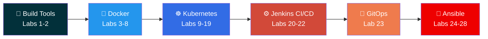
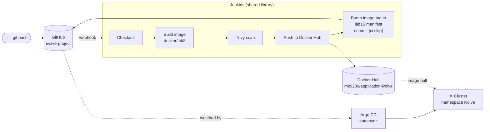
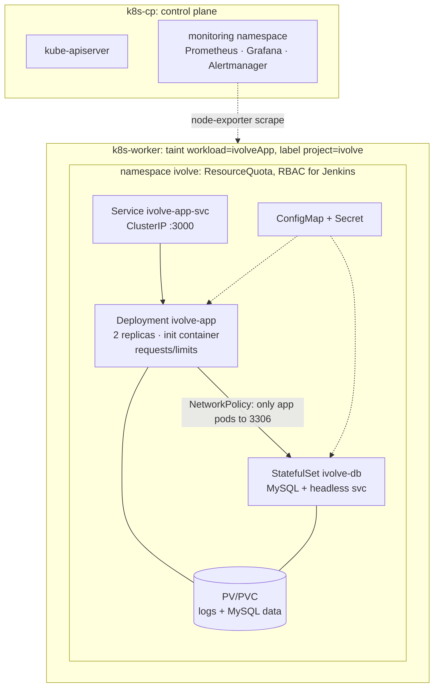
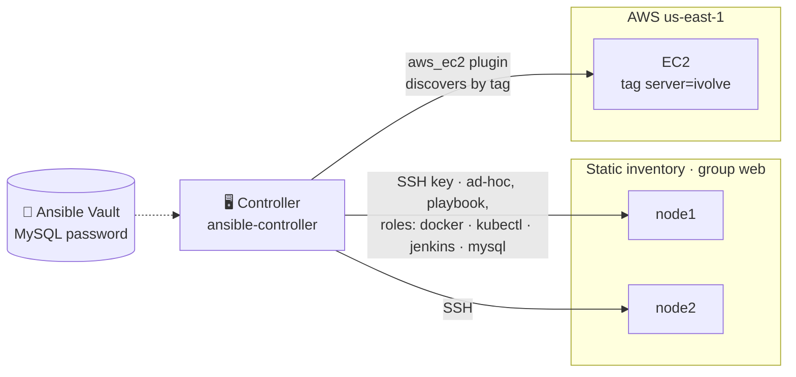
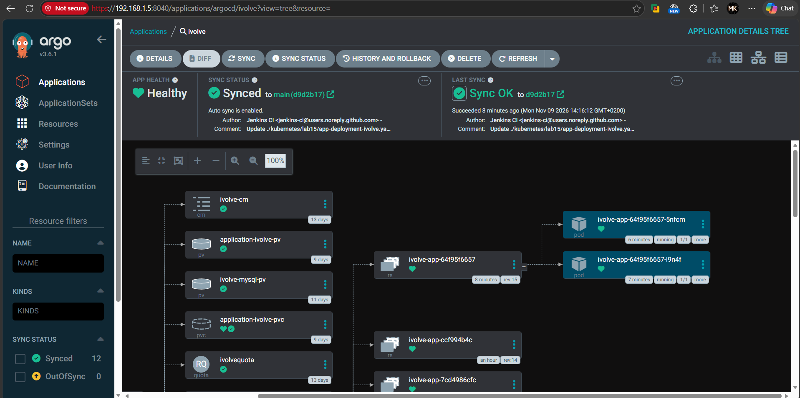
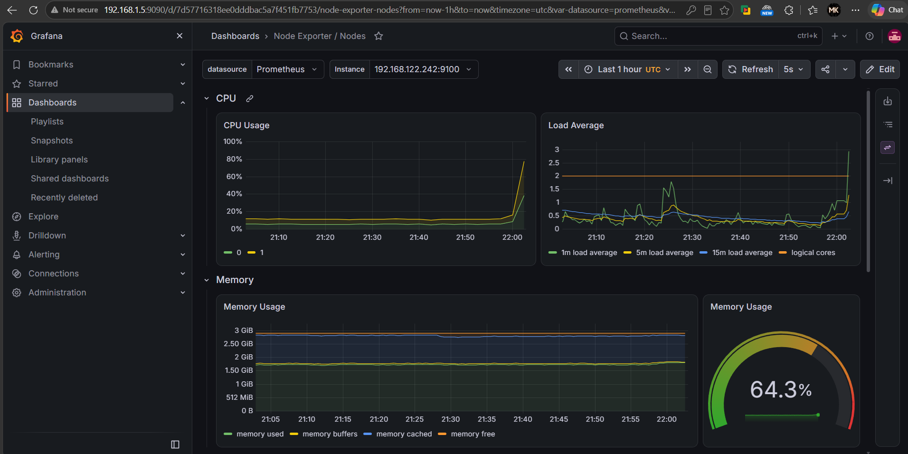
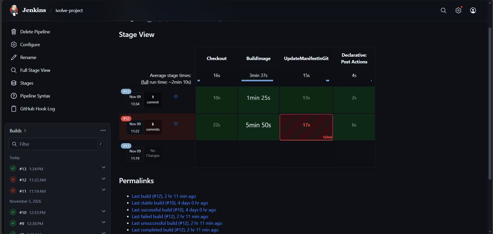
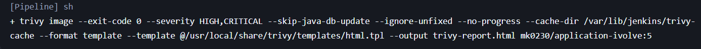

<div align="center">

# iVolve DevOps Internship Labs

**28 hands-on labs: from `gradle build` to GitOps on Kubernetes and Ansible-automated servers.**

[](https://moaz-elgendy.github.io/ivolve-project/)


</div>

---

## About

This repository holds my work from the **iVolve DevOps internship**. Each lab builds on the previous one. A small Node.js + MySQL application starts as a local build, becomes a hardened container image, runs on a self-built two-VM Kubernetes cluster, and ships through a Jenkins + Argo CD GitOps pipeline. The last labs automate server setup with Ansible, from ad-hoc commands to roles, Vault and AWS dynamic inventory.

Every lab folder has its own `README.md` with the steps, the manifests or code, and screenshots as evidence.

## Learning path



## Final pipeline: GitOps flow (Lab 23)



Jenkins never touches the cluster. It builds, scans, pushes, and commits the new tag. Argo CD applies the commit. The `[ci skip]` marker stops Jenkins from rebuilding on its own commit.

## Cluster architecture (Labs 9-19)



Cluster: kubeadm, Kubernetes v1.35.9, containerd, Flannel, on two VMs.

## Ansible automation (Labs 24-28)



## Labs

### 🔨 Build tools

| # | Lab | Highlights |
|---|---|---|
| 1 | [Gradle build](build-tools/lab1) | Compile, test, JAR, run with the Gradle wrapper |
| 2 | [Maven build](build-tools/lab2) | Maven lifecycle: compile, test, package |

### 🐳 Docker

| # | Lab | Highlights |
|---|---|---|
| 3 | [Dockerize a Java app](docker/lab3) | Maven-in-image vs. JAR-on-JRE, image size comparison |
| 4 | [Multi-stage build](docker/lab4) | Spring Boot single vs. multi-stage, `docker save` / `load` |
| 5 | [Trivy image scanning](docker/lab5) | Scan, harden the Dockerfile, re-scan, compare |
| 6 | [Env vars & resource limits](docker/lab6) | 3 ways to pass env vars, CPU/memory limits, `docker stats` |
| 7 | [Microservices networking](docker/lab7) | 3 Flask services, 2 isolated bridge networks, volumes |
| 8 | [Docker Compose](docker/lab8) | Node.js + MySQL 8.4, custom network, push to Docker Hub |

### ☸️ Kubernetes

| # | Lab | Highlights |
|---|---|---|
| 9 | [Two-VM kubeadm cluster](kubernetes/lab9) | Control plane + worker, containerd, Flannel |
| 10 | [Taints & labels](kubernetes/lab10) | Dedicate the worker node to the app |
| 11 | [ResourceQuota](kubernetes/lab11) | Cap the `ivolve` namespace at 3 pods |
| 12 | [ConfigMaps & Secrets](kubernetes/lab12) | DB config and credentials |
| 13 | [PV & PVC](kubernetes/lab13) | `hostPath` volume, `Retain` policy |
| 14 | [StatefulSet](kubernetes/lab14) | MySQL, headless Service, StorageClass, local PV |
| 15 | [Deployment & Service](kubernetes/lab15) | Init container waits for MySQL, persistent logs |
| 16 | [Requests & limits](kubernetes/lab16) | Debug `Insufficient cpu`, metrics-server, `kubectl top` |
| 17 | [NetworkPolicy](kubernetes/lab17) | Only app pods reach MySQL on 3306 |
| 18 | [Monitoring with Helm](kubernetes/lab18) | kube-prometheus-stack, Grafana Node Exporter dashboards |
| 19 | [RBAC for Jenkins](kubernetes/lab19) | ServiceAccount, Role, RoleBinding, least privilege |

### ⚙️ Jenkins & GitOps

| # | Lab | Highlights |
|---|---|---|
| 20 | [Jenkins RBAC](jenkins/lab20) | Role-based strategy: admin vs. read-only users |
| 21 | [Declarative pipeline](jenkins/lab21) | Build, Trivy report, push, cleanup, deploy to K8s |
| 22 | [Agents & shared library](jenkins/lab22) | `buildApp` / `deployKubernetes` steps, `k8s-agent` node |
| 23 | [GitOps with Argo CD](argocd/lab23) | Jenkins commits the tag, Argo CD auto-syncs |

### 🤖 Ansible

| # | Lab | Highlights |
|---|---|---|
| 24 | [Setup & ad-hoc commands](ansible/lab24) | Controller + 2 nodes, SSH keys, inventory, Docker via ad-hoc |
| 25 | [Playbooks](ansible/lab25) | One playbook installs Docker, kubectl, Jenkins |
| 26 | [Roles](ansible/lab26) | Split into `docker`, `kubectl`, `jenkins` roles, checksum-verified kubectl |
| 27 | [Ansible Vault](ansible/lab27) | MySQL role, `ivolve` DB and user, password in Vault |
| 28 | [Dynamic inventory](ansible/lab28) | EC2 via AWS CLI, `aws_ec2` plugin discovers `server=ivolve` |

## Highlights

| Argo CD: Healthy & Synced | Grafana: Node Exporter |
|---|---|
|  |  |
| **Jenkins: pipeline stages** | **Trivy: image scan** |
|  |  |

## Skills demonstrated

- **Build & package:** Gradle, Maven, Java 17, Spring Boot, Node.js, Flask
- **Containers:** multi-stage builds, image size tuning, env-based config, resource limits, bridge networks, volumes, Compose
- **Security:** Trivy scanning and Dockerfile hardening, Kubernetes Secrets, NetworkPolicy, RBAC in Kubernetes and Jenkins
- **Kubernetes:** kubeadm install, scheduling (taints, tolerations, labels), quotas, storage (PV, PVC, StorageClass, StatefulSet), init containers, rolling updates
- **Observability:** Helm, Prometheus, Grafana, metrics-server
- **CI/CD:** declarative pipelines, shared libraries, distributed agents, webhooks, GitOps with Argo CD
- **Configuration management:** Ansible ad-hoc commands, playbooks, roles, Vault, AWS dynamic inventory
- **Cloud:** AWS EC2, key pairs, security groups, tag-based discovery
- **Troubleshooting:** each lab README records real failures and fixes, such as `Insufficient cpu` scheduling, metrics-server TLS errors, and Argo CD `Degraded` on the init container

## Repository layout

```text
ivolve-project/
├── build-tools/   # Labs 1-2   Gradle, Maven
├── docker/        # Labs 3-8   Dockerfiles, Trivy, networking, Compose
├── kubernetes/    # Labs 9-19  manifests, Helm values, RBAC
├── jenkins/       # Labs 20-22 Jenkinsfile, shared library (vars/)
├── argocd/        # Lab 23     GitOps Jenkinsfile + pushGithub step
├── ansible/       # Labs 24-28 playbooks, roles, Vault, EC2 dynamic inventory
└── docs/          # GitHub Pages presentation
```

## Quick start

```bash
git clone https://github.com/Moaz-Elgendy/ivolve-project.git
cd ivolve-project/docker/lab8
docker compose up --build    # app on http://localhost:3000
```

For any other lab, open its folder and follow its `README.md`.

## Author

**Moaz Elgendy** · DevOps Intern at iVolve · [GitHub](https://github.com/Moaz-Elgendy)
