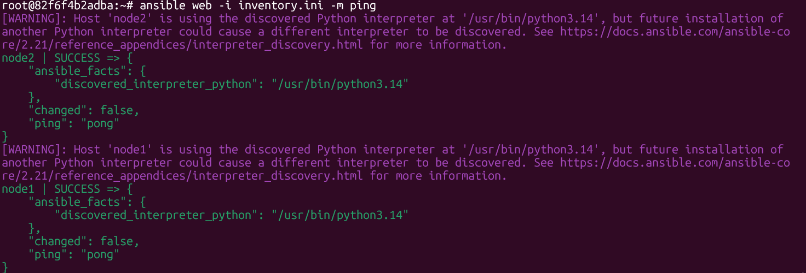
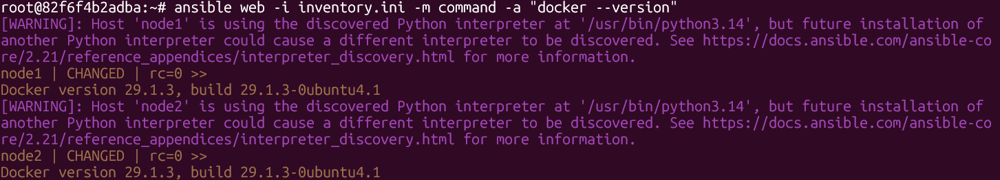

# Lab 24: Initial Ansible Configuration and Ad-Hoc Commands

## Objective

Install Ansible on a controller, connect it to two managed nodes over SSH with key-based authentication, define an inventory, and verify the setup with ad-hoc commands, including installing Docker on both nodes.

## Lab Environment

Docker containers simulate Ubuntu machines.

| Role             | Container            | Inventory alias |
|------------------|----------------------|-----------------|
| Controller       | `ansible-controller` | n/a             |
| Managed node 1   | `slave-1`            | `node1`         |
| Managed node 2   | `slave-2`            | `node2`         |

## Steps

### 1. Install Ansible on the controller

```bash
docker exec -it ansible-controller bash
apt update
apt install -y python3 python3-pip openssh-client
pip3 install ansible
ansible --version
```

### 2. Generate an SSH key

```bash
ssh-keygen -t ed25519 -f ~/.ssh/ansible-key -N ""
```

### 3. Copy the public key to each node

```bash
ssh-copy-id -i ~/.ssh/ansible-key.pub root@<slave-1-container-id>
ssh-copy-id -i ~/.ssh/ansible-key.pub root@<slave-2-container-id>
```

Verify passwordless login:

```bash
ssh -i ~/.ssh/ansible-key root@<slave-1-container-id> hostname
ssh -i ~/.ssh/ansible-key root@<slave-2-container-id> hostname
```

### 4. Create the inventory (`inventory.ini`)

```ini
[web]
node1 ansible_host=922264ab74ff ansible_user=root
node2 ansible_host=f8c37d65312c ansible_user=root

[web:vars]
ansible_ssh_private_key_file=/root/.ssh/ansible-key
```

| Field          | Meaning                                      |
|----------------|----------------------------------------------|
| `node1`, `node2` | Aliases used in Ansible commands           |
| `ansible_host`   | Address Ansible connects to (container ID) |
| `ansible_user`   | SSH user on the node                       |

### 5. Check connectivity

```bash
ansible web -i inventory.ini --list-hosts
ansible web -i inventory.ini -m ping
```



### 6. Install Docker with an ad-hoc command

```bash
ansible web -i inventory.ini -m apt -a "name=docker.io state=present update_cache=yes"
ansible web -i inventory.ini -m command -a "docker --version"
```



Both nodes return `Docker version 29.1.3`.

## Ad-Hoc Command Syntax

```text
ansible <host-pattern> -i <inventory> -m <module> -a "<module arguments>"
```

| Part             | Example            | Purpose                          |
|------------------|--------------------|----------------------------------|
| `<host-pattern>` | `web`              | Group or host from the inventory |
| `-i`             | `inventory.ini`    | Inventory file                   |
| `-m`             | `ping`, `apt`      | Module to run                    |
| `-a`             | `"name=docker.io"` | Module arguments                 |

## Verification Checklist

- [x] `ansible --version` prints a version on the controller.
- [x] SSH logs in to both nodes without a password.
- [x] `ansible web -m ping` returns `pong` from `node1` and `node2`.
- [x] `ansible web -m command -a "docker --version"` returns a version from both nodes.

## Troubleshooting

| Symptom                                       | Fix                                                      |
|-----------------------------------------------|----------------------------------------------------------|
| `UNREACHABLE! ... Permission denied`          | Re-run `ssh-copy-id`, check `ansible_ssh_private_key_file` |
| `UNREACHABLE! ... Could not resolve hostname` | Use the container IP address instead of the ID           |
| `ansible: command not found`                  | Check `pip3 show ansible` and `PATH`                     |
| `apt` module fails with a lock error          | Wait for the package manager on the node, then re-run    |

## Key Takeaways

- Ansible needs Python and SSH on the controller. Managed nodes need SSH and Python.
- Key-based SSH lets Ansible run without password prompts.
- The inventory maps friendly names to hosts and groups them, so one command can target many nodes.
- Ad-hoc commands suit quick checks and one-off tasks. Repeatable configuration belongs in playbooks.
