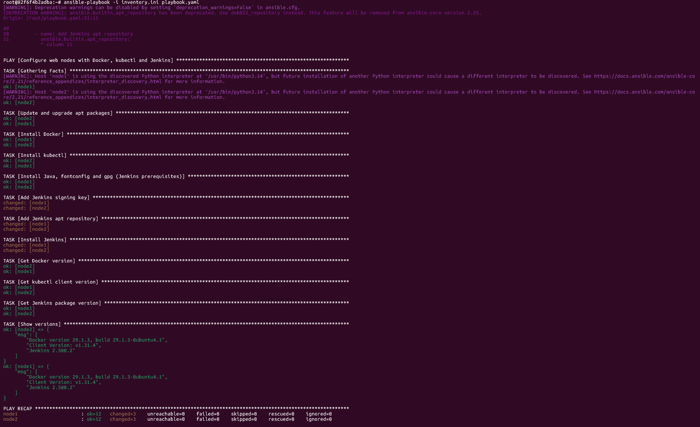
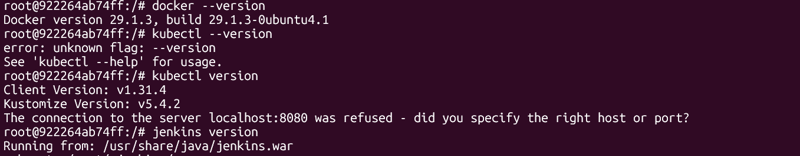

# Lab 25: Automated Web Server Configuration Using Ansible Playbooks

## Objective

Write one playbook that installs Docker, kubectl and Jenkins on the managed nodes from Lab 24, then verify the result on each node.

## Files

| File           | Purpose                                      |
|----------------|----------------------------------------------|
| `playbook.yml` | Installs Docker, kubectl and Jenkins on `web` |

The inventory is reused from Lab 24 (`../lab24/inventory.ini`). No `ansible.cfg` is used, so pass the inventory with `-i`.

## Tasks

| Tool    | Method                                                        |
|---------|---------------------------------------------------------------|
| Update  | `apt` runs `update_cache` and `upgrade: dist` first           |
| Docker  | `apt` installs `docker.io`                                    |
| kubectl | `get_url` downloads the pinned `v1.31.4` binary with SHA-256 check |
| Jenkins | `apt` installs Java and Jenkins from the official Jenkins repo |

## Run

From this directory on the controller:

```bash
ansible-playbook -i ../lab24/inventory.ini playbook.yml
```

Run a single tool with tags: `--tags docker`, `--tags kubectl`, `--tags jenkins`. Print versions only with `--tags verify`.

## Verify on the Managed Nodes

```bash
ansible web -i ../lab24/inventory.ini -m command -a "docker --version"
ansible web -i ../lab24/inventory.ini -m command -a "kubectl version --client"
ansible web -i ../lab24/inventory.ini -m command -a "dpkg-query -W -f='\${Version}' jenkins"
```

Or run `ansible-playbook -i ../lab24/inventory.ini playbook.yml --tags verify`.

## Screenshots

Playbook run, both nodes `failed=0`:



Manual check on node1: Docker, kubectl and Jenkins versions:



## Assumptions

- Managed nodes are Ubuntu 26.04 (`openjdk-21-jre-headless` installs there). Change the Java package if the OS differs.
- kubectl is `amd64` only.
- Nodes are Docker containers with no systemd (PID 1 is `bash`), so the playbook installs packages only and does not start services. Start `dockerd` and Jenkins by hand, or ignore the daemons: the verify step checks binaries only.

## Verification Checklist

- [x] Playbook finishes with `failed=0` on `node1` and `node2`.
- [x] `docker --version` prints a version on both nodes.
- [x] `kubectl version --client` prints a version on both nodes.
- [x] Jenkins package is installed on both nodes.

## Troubleshooting

| Symptom                                   | Fix                                                        |
|-------------------------------------------|------------------------------------------------------------|
| `Unable to locate package openjdk-21-jre-headless` | Node is not Ubuntu 26.04. Use the Java package for its OS |
| `apt` lock error                          | Wait for the package manager on the node, then re-run      |
| `NO_PUBKEY` / `repository is not signed`  | Jenkins rotated its signing key. Check `https://pkg.jenkins.io/debian-stable/` for the current `jenkins.io-YYYY.key` and update `jenkins_key_url` |
