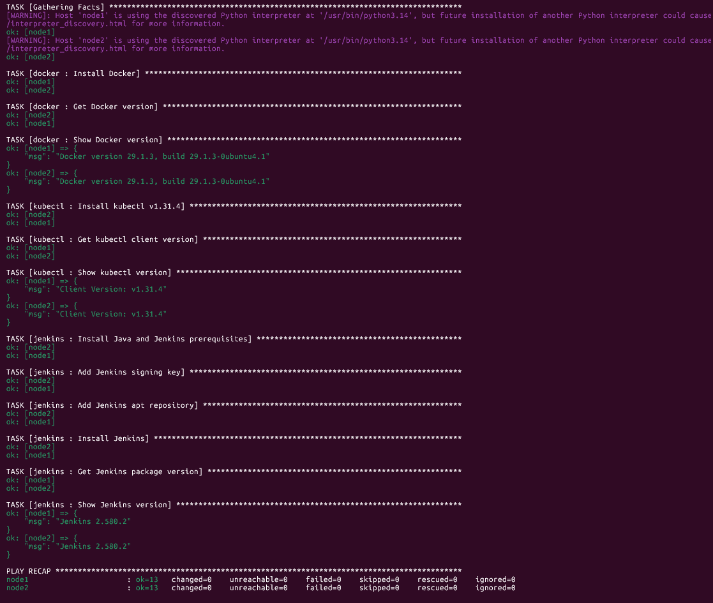

# Lab 26: Structured Configuration Management with Ansible Roles

## Objective

Move the Lab 25 playbook into separate Ansible roles, one each for Docker, kubectl and Jenkins. A top-level playbook runs the three roles on the `web` group from Lab 24.

## Files

| File / Directory        | Purpose                                              |
|-------------------------|------------------------------------------------------|
| `site.yml`              | Playbook that applies the `docker`, `kubectl` and `jenkins` roles to `web` |
| `roles/docker/`         | Installs Docker (`docker.io`) and prints its version |
| `roles/kubectl/`        | Downloads the pinned kubectl binary, checks its SHA-256, prints its version |
| `roles/jenkins/`        | Installs Java, adds the Jenkins repo and key, installs Jenkins, prints its version |

The inventory is reused from Lab 24 (`../lab24/inventory.ini`). No `ansible.cfg` is used, so pass the inventory with `-i`.

## Role Layout

Each role follows the standard Ansible layout. Only the directories a role needs are present.

```text
roles/<role>/
├── defaults/main.yml   # Variables that a caller may override
└── tasks/main.yml      # Install steps and tagged verify steps
```

| Role      | Variable                | Default                                  |
|-----------|-------------------------|------------------------------------------|
| `docker`  | `docker_package`        | `docker.io`                              |
| `kubectl` | `kubectl_version`       | `v1.31.4`                                |
| `kubectl` | `kubectl_bin_dir`       | `/usr/local/bin`                         |
| `jenkins` | `jenkins_java_package`  | `openjdk-21-jre-headless`                |
| `jenkins` | `jenkins_key_url`       | `https://pkg.jenkins.io/debian-stable/jenkins.io-2026.key` |
| `jenkins` | `jenkins_keyring`       | `/usr/share/keyrings/jenkins-keyring.asc` |

Override a default from the command line with `-e`, for example `-e kubectl_version=v1.32.0`.

## The Playbook

```yaml
- name: Configure web nodes with Docker, kubectl and Jenkins roles
  hosts: web
  become: true

  roles:
    - role: docker
      tags: [docker]
    - role: kubectl
      tags: [kubectl]
    - role: jenkins
      tags: [jenkins]
```

Each role carries its own tag, so you can run one role at a time.

## Run

From this directory on the controller:

```bash
ansible-playbook -i ../lab24/inventory.ini site.yml
```

Run a single role with tags:

```bash
ansible-playbook -i ../lab24/inventory.ini site.yml --tags docker
ansible-playbook -i ../lab24/inventory.ini site.yml --tags kubectl
ansible-playbook -i ../lab24/inventory.ini site.yml --tags jenkins
```

Print only the installed versions:

```bash
ansible-playbook -i ../lab24/inventory.ini site.yml --tags verify
```

Check the syntax without touching the nodes:

```bash
ansible-playbook -i ../lab24/inventory.ini site.yml --syntax-check
```

## Verify on the Managed Nodes

```bash
ansible web -i ../lab24/inventory.ini -m command -a "docker --version"
ansible web -i ../lab24/inventory.ini -m command -a "kubectl version --client"
ansible web -i ../lab24/inventory.ini -m command -a "dpkg-query -W -f='\${Version}' jenkins"
```

## Screenshots

Playbook run with all three roles, both nodes `failed=0` and `changed=0`:



## Verification Checklist

- [ ] `ansible-playbook --syntax-check site.yml` passes.
- [x] Playbook finishes with `failed=0` on `node1` and `node2`.
- [x] `docker --version` prints a version on both nodes.
- [x] `kubectl version --client` prints a version on both nodes.
- [x] Jenkins package is installed on both nodes.
- [x] Re-running the playbook reports `changed=0` (idempotency).

## Differences from Lab 25

- Tasks now live in roles, so each tool can be changed or reused without editing the whole playbook.
- Variables moved to each role's `defaults/main.yml`, so they can be overridden per run.
- The full `apt upgrade: dist` step from Lab 25 is not in any role. Run it once by hand or in a separate play if you need it.

## Troubleshooting

| Symptom                                   | Fix                                                        |
|-------------------------------------------|------------------------------------------------------------|
| `role 'docker' was not found`             | Run the playbook from `lab26/`, so `roles/` sits next to `site.yml` |
| `Unable to locate package openjdk-21-jre-headless` | Node is not Ubuntu 26.04. Set `jenkins_java_package` for its OS |
| `NO_PUBKEY` / `repository is not signed`  | Jenkins rotated its signing key. Update `jenkins_key_url`  |
| `apt` lock error                          | Wait for the package manager on the node, then re-run      |

## Key Takeaways

- A role packages tasks, variables and tags for one job. The playbook only chooses which roles run on which hosts.
- Defaults in `defaults/main.yml` are easy to override. Tasks should not hard-code values that change between environments.
- Tags on roles let you run one piece of a large configuration without changing the code.
