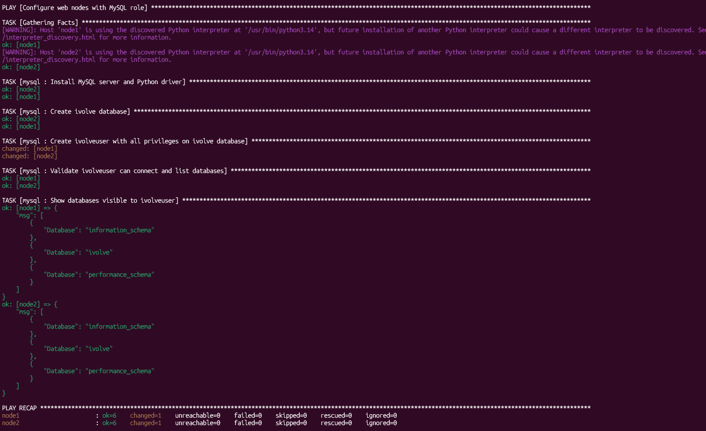
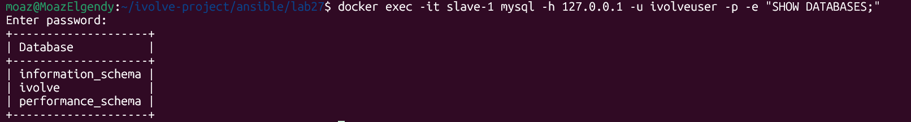

# Lab 27: Securing Sensitive Data with Ansible Vault

## Objective

Create a MySQL role that installs MySQL, creates the `ivolve` database and the `ivolveuser` user with all privileges on it. Store the user's password in an Ansible Vault file, then connect as `ivolveuser` on each node and list the databases.

## Files

| File                               | Purpose                                              |
|------------------------------------|------------------------------------------------------|
| `mysql-site.yml`                   | Playbook that applies the `mysql` role to `web`      |
| `roles/mysql/defaults/main.yml`    | Role variables (package, socket, database, user, auth plugin) |
| `roles/mysql/tasks/main.yml`       | Install MySQL, create DB and user, validate login    |
| `group_vars/web/vars.yml`          | Plain variables; reads the password from the vault   |
| `group_vars/web/vault.yml.example` | Vault template. Copy it, never commit real secrets   |
| `group_vars/web/vault.yml`         | Encrypted vault file you create (Step 1)             |
| `screenshots/`                     | Run and validation screenshots                       |

The inventory is reused from Lab 24 (`../lab24/inventory.ini`). `group_vars/web/` loads automatically because its name matches the `web` group.

## Prerequisites

On the controller, install the collection that provides the `mysql_*` modules:

```bash
ansible-galaxy collection install community.mysql
```

## Step 1: Create the Encrypted Vault File

```bash
ansible-vault create group_vars/web/vault.yml
```

Enter a vault password twice, then add this line in the editor:

```yaml
vault_mysql_password: "YourStrongPassword123"
```

Other vault commands:

| Command                                          | Purpose                       |
|--------------------------------------------------|-------------------------------|
| `ansible-vault view group_vars/web/vault.yml`    | Show the decrypted content    |
| `ansible-vault edit group_vars/web/vault.yml`    | Change the content            |
| `ansible-vault rekey group_vars/web/vault.yml`   | Change the vault password     |

## Step 2: Start MySQL on the Nodes

The nodes are containers without systemd, so the role installs MySQL but does not start it. Start `mysqld` once per node:

```bash
docker exec -it slave-1 bash -c "mysqld_safe --user=mysql > /dev/null 2>&1 &"
docker exec -it slave-2 bash -c "mysqld_safe --user=mysql > /dev/null 2>&1 &"
```

## Step 3: Run the Playbook

Copy the role to the controller (the controller uses `/root`):

```bash
docker cp roles/mysql ansible-controller:/root/roles/
docker cp mysql-site.yml ansible-controller:/root/
```

Run it from the controller:

```bash
docker exec -it ansible-controller bash -c "cd /root && ansible-playbook -i lab24/inventory.ini mysql-site.yml --ask-vault-pass"
```

Expected result: `failed=0` on both nodes. The user task reports `changed=1` on every run because it re-sets the password.



## Step 4: Validate Manually

Log in as `ivolveuser` and list the databases:

```bash
docker exec -it slave-1 mysql -h 127.0.0.1 -u ivolveuser -p -e "SHOW DATABASES;"
```

Enter the vault password. The output must include `ivolve`. Repeat for `slave-2`.



## Verification Checklist

- [x] `ansible-playbook --syntax-check mysql-site.yml` passes.
- [x] Playbook finishes with `failed=0` on `node1` and `node2`.
- [x] `SHOW DATABASES;` as `ivolveuser` lists `ivolve`.

## Key Decisions

- **Auth plugin:** MySQL 8.4+ disables `mysql_native_password`. The role sets `mysql_auth_plugin: caching_sha2_password`.
- **User creation:** Done with plain SQL through `community.mysql.mysql_query`. The `mysql_user` module failed with error 1524 on MySQL 8.4.
- **Privileges:** `GRANT ALL PRIVILEGES ON ivolve.*` only. No global privileges.
- **Secrets:** The password is set with `no_log: true`, so Ansible does not print it.
- **Host:** `ivolveuser` is created for `%` so remote connections work. Narrow it to `localhost` if you do not need them.

## Troubleshooting

| Symptom                                                  | Fix                                                                  |
|----------------------------------------------------------|----------------------------------------------------------------------|
| `ERROR 2002 Can't connect to local MySQL server`         | `mysqld` is not running. Repeat Step 2                               |
| `Plugin 'mysql_native_password' is not loaded` (1524)    | Old role copy on the controller. Re-copy `roles/mysql` and re-run    |
| `cryptography is required` / PyMySQL error               | Install `python3-cryptography` on the node (role does this)          |
| `Decryption failed` / vault prompt error                 | Wrong vault password                                                 |
| `ERROR 1045 Access denied`                               | Password in vault differs from the stored one. Re-run the playbook   |
| `unable to locate package mysql-server`                  | Node is not Ubuntu. Change `mysql_package` for its OS                |
| `community.mysql.mysql_query` not found                  | Run `ansible-galaxy collection install community.mysql`              |

## Key Takeaways

- Ansible Vault encrypts a file, so secrets can live in the repo without being readable.
- Keep plain variables in `vars.yml` and reference `vault_*` variables from there.
- `no_log` hides secret values from task output.
- Validate the way a user would: log in with the new credentials and run a query.
