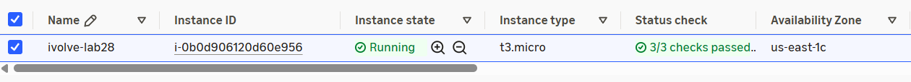
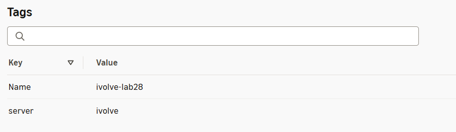

# Lab 28: Automated Host Discovery with Ansible Dynamic Inventory

**Status: Done**

## Objective

Create an EC2 instance tagged `server=ivolve`, discover it with a dynamic inventory, list it with `ansible-inventory`, run a playbook on it, and verify the result.

## Files

| File            | Purpose                                                      |
|-----------------|--------------------------------------------------------------|
| `create-ec2.sh` | Creates key pair, security group and tagged EC2 (AWS CLI)    |
| `aws_ec2.yml`   | Dynamic inventory: running instances tagged `server=ivolve`  |
| `ansible.cfg`   | Uses `aws_ec2.yml` and enables the AWS inventory plugin      |
| `site.yml`      | Installs nginx, deploys a page, verifies it                  |
| `screenshots/`  | EC2 console screenshots                                      |

## Prerequisites

- AWS CLI configured.
- On the controller: `pip3 install --user --break-system-packages boto3` and `ansible-galaxy collection install amazon.aws`.

## Steps

- [x] **1. Create EC2:** `./create-ec2.sh` (Ubuntu 26.04, `t3.micro`, `us-east-1`). Ports 22 and 80 open to your IP only.
- [x] **2. List hosts:** `ansible-inventory --graph` shows `ivolve-lab28` under `@server_ivolve`.
- [x] **3. Run playbook:** `ansible-playbook site.yml` finishes with `failed=0`.
- [x] **4. Verify:** `curl http://<public-ip>/` returns the page; `systemctl is-active nginx` returns `active`.

## Screenshots

EC2 instance running:



Tags `Name=ivolve-lab28` and `server=ivolve`:



## Verification Checklist

- [x] `create-ec2.sh` prints the instance ID, public IP and `running`.
- [x] `ansible-inventory --graph` lists `ivolve-lab28` under `server_ivolve`.
- [x] `ansible-playbook site.yml` finishes with `failed=0`.
- [x] `curl http://<public-ip>/` returns the page.
- [x] `systemctl is-active nginx` returns `active`.

## Cleanup

The instance bills while running:

```bash
aws ec2 terminate-instances --instance-ids <instance-id>
```

## Troubleshooting

| Symptom                                        | Fix                                                              |
|------------------------------------------------|------------------------------------------------------------------|
| No hosts in `ansible-inventory --graph`        | Instance not `running`, or tag is not exactly `server=ivolve`    |
| `No module named 'boto3'`                      | `pip3 install --user --break-system-packages boto3`              |
| `UNREACHABLE ... timed out` / `curl` times out | Your IP changed. Update the ports 22 and 80 rules                |
| `Permission denied (publickey)`                | Check `~/.ssh/ivolve-lab28.pem` and `ansible_user: ubuntu`       |
| `Host key verification failed`                 | Remove the old entry from `~/.ssh/known_hosts`                   |

## Key Takeaways

- A dynamic inventory asks the cloud API for hosts, so no inventory file needs editing when instances change.
- `keyed_groups` turns the `server` tag into the `server_ivolve` group the playbook targets.
