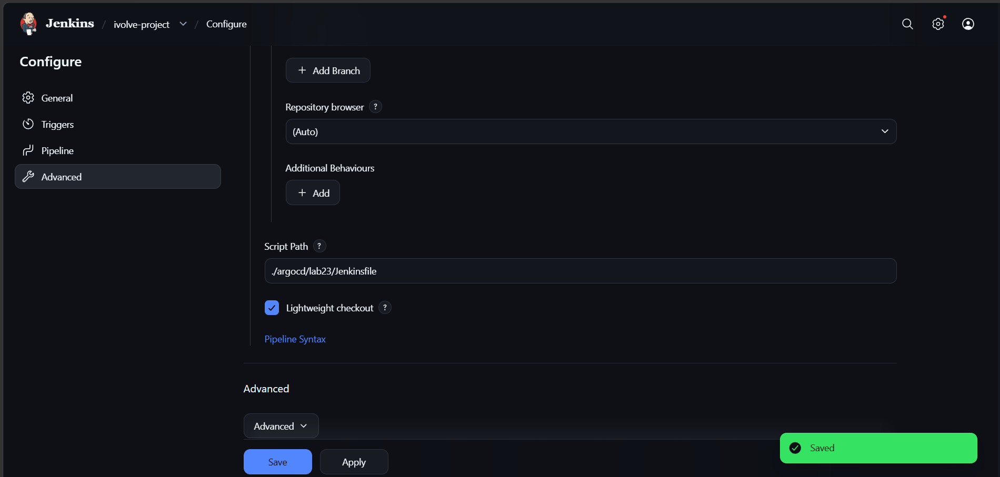
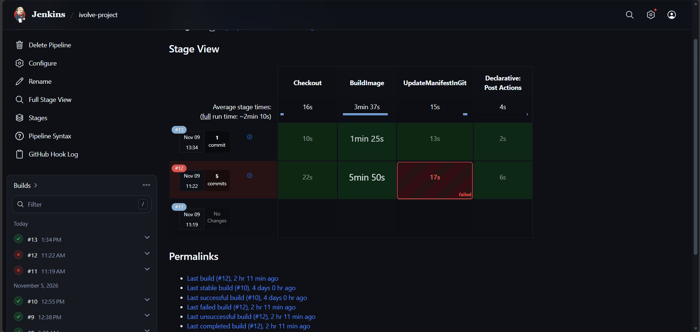
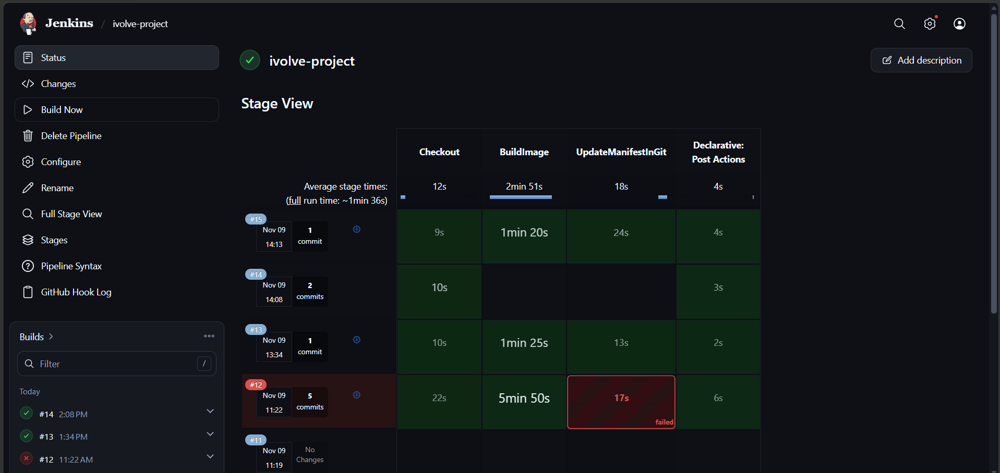
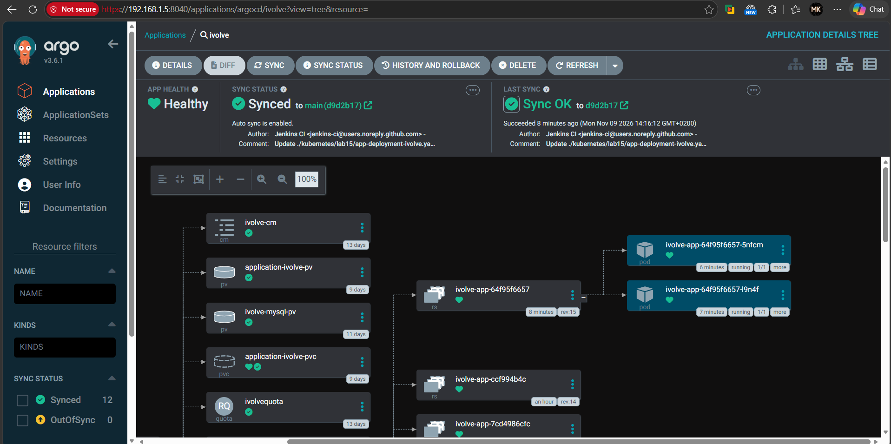
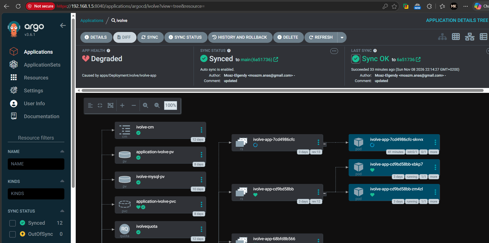

# Lab 23: GitOps with Jenkins and Argo CD

This lab moves deployment out of Jenkins and into Git.

- **Jenkins** builds the application image, pushes it to Docker Hub, and commits the new image tag to the GitHub repository. It no longer connects to the cluster.
- **Argo CD** watches the repository and applies every new commit to the `ivolve` namespace automatically (auto-sync).

Result: a `git push` to `main` produces a new image, a manifest commit, and a rollout, with no manual `kubectl apply`.

---

## 1. Environment

| Item | Value |
|---|---|
| Kubernetes namespace for the app | `ivolve` (created in earlier labs) |
| Argo CD namespace | `argocd` |
| Argo CD version | v3.6.1 |
| Git repository | `https://github.com/Moaz-Elgendy/ivolve-project.git`, branch `main` |
| Manifest watched by Argo CD | `kubernetes/lab15/` (contains `app-deployment-ivolve.yaml`) |
| Argo CD UI address in my setup | `http://192.168.1.5:8040` |
| Jenkins job | `ivolve-project`, Pipeline script path `./argocd/lab23/Jenkinsfile` |

Earlier labs already provide the `ivolve` namespace, the ConfigMap `ivolve-cm`, the Secret `ivolve-secret`, the MySQL StatefulSet `ivolve-db` with Service `ivolve-db-svc`, and the image pull secret `docker-hub-secret`.

---

## 2. Install Argo CD

### 2.1 Create the namespace

```bash
kubectl create namespace argocd
```

### 2.2 Install the Argo CD manifests

```bash
kubectl apply -n argocd -f https://raw.githubusercontent.com/argoproj/argo-cd/stable/manifests/install.yaml
kubectl -n argocd get pods -w
```

Wait until every pod in `argocd` is `Running` and `1/1` (or `2/2` for the application controller).

```bash
kubectl -n argocd rollout status deployment/argocd-server
```

### 2.3 Open the UI

The UI is served by the `argocd-server` Service. Port-forward it to reach it from the workstation:

```bash
kubectl port-forward svc/argocd-server -n argocd 8080:443
```

Then open `https://localhost:8080`. In my setup the UI was reachable at `http://192.168.1.5:8040` (see the URL bar in the screenshots below).

### 2.4 Log in

Get the initial `admin` password generated by the installer:

```bash
kubectl -n argocd get secret argocd-initial-admin-secret -o jsonpath="{.data.password}" | base64 -d; echo
```

Log in at the UI with user `admin` and that password. Then change the password under **User Info → Update Password** and delete the initial secret if you do not need it.

Optional CLI login:

```bash
argocd login localhost:8080 --username admin --insecure
```

---

## 3. Connect Argo CD to GitHub

In the UI go to **Settings → Repositories → Connect Repo**:

- Connection method: `VIA HTTPS`
- Repository URL: `https://github.com/Moaz-Elgendy/ivolve-project.git`
- For a private repository, add the GitHub username and a personal access token with `repo` read access.

Or from the CLI:

```bash
argocd repo add https://github.com/Moaz-Elgendy/ivolve-project.git
```

The repository must show a successful connection before the application is created.

---

## 4. Create the `ivolve` application

Argo CD should deploy the Deployment that Jenkins updates, so the source path must be `kubernetes/lab15`.

### 4.1 From the UI

**Applications → New App** and set:

| Field | Value |
|---|---|
| Application Name | `ivolve` |
| Project | `default` |
| Sync Policy | `Automatic` |
| Prune Resources | enabled |
| Self Heal | enabled |
| Repository URL | `https://github.com/Moaz-Elgendy/ivolve-project.git` |
| Revision | `main` |
| Path | `kubernetes/lab15` |
| Cluster URL | `https://kubernetes.default.svc` |
| Namespace | `ivolve` |

### 4.2 From the CLI (same settings)

```bash
argocd app create ivolve \
  --repo https://github.com/Moaz-Elgendy/ivolve-project.git \
  --path kubernetes/lab15 \
  --revision main \
  --dest-server https://kubernetes.default.svc \
  --dest-namespace ivolve \
  --sync-policy automated \
  --self-heal \
  --auto-prune
```

What the three options do:

- **Automatic sync:** Argo CD applies a change as soon as it is committed to `main`, without a manual **Sync** click.
- **Self Heal:** if someone changes a live object with `kubectl`, Argo CD reverts it to the Git version.
- **Prune:** if a manifest is deleted from Git, Argo CD deletes the object from the cluster.

Only `kubernetes/lab15` is managed by Argo CD. The ConfigMap in `kubernetes/lab12` is outside that path. Changes to it must be applied with `kubectl`, as described in section 7.

---

## 5. Connect Jenkins to the repository and GitHub

The Jenkins job `ivolve-project` is a Pipeline job that reads its script from Git:

- **Definition:** Pipeline script from SCM, SCM = Git
- **Repository URL:** `https://github.com/Moaz-Elgendy/ivolve-project.git`
- **Credentials:** `github` (username + personal access token with `repo` scope)
- **Branch:** `*/main`
- **Script Path:** `./argocd/lab23/Jenkinsfile`
- **Lightweight checkout:** enabled



### 5.1 Jenkins prerequisites

| Item | Name / setting |
|---|---|
| Credential: GitHub (username + token) | `github` |
| Credential: Docker Hub | `docker-hub` |
| Global Pipeline Library | `shared-lib`, containing `vars/buildApp.groovy` and `vars/pushGithub.groovy` |
| Plugin | GitHub plugin (provides `githubPush()`) |
| GitHub webhook | Payload URL `http://<jenkins-host>:<port>/github-webhook/`, content type `application/json`, event: push |

The webhook is what starts a build on every push. The `github` credential is what lets Jenkins push the manifest commit. They are separate: the credential alone does not start builds.

### 5.2 Pipeline stages

[Jenkinsfile](Jenkinsfile) has three stages, all on the `built-in` agent:

| Stage | What it does |
|---|---|
| `Checkout` | Checks out the repository and stashes the Docker build context and the manifest. |
| `BuildImage` | Runs `buildApp`: `docker build`, Trivy scan (non-blocking), `docker push mk0230/application-ivolve:<BUILD_NUMBER>`. |
| `UpdateManifestInGit` | Runs `pushGithub`: sets the image tag in `kubernetes/lab15/app-deployment-ivolve.yaml`, commits, and pushes to `main`. |

Changes from Lab 22:

- `triggers { githubPush() }` starts the pipeline on every push.
- The `DeployKubernetes` stage on the `k8s-agent` node is replaced by `UpdateManifestInGit`. The `jenkins-kubeconfig` credential is no longer used.
- Every stage has `when { not { changelog '.*\\[ci skip\\].*' } }`. The commit Jenkins makes contains `[ci skip]`, so it does not start another build.

### 5.3 What `pushGithub` does

[pushGithub.groovy](pushGithub.groovy):

1. Reads the manifest and replaces the `image:` line for `mk0230/application-ivolve` with `mk0230/application-ivolve:<BUILD_NUMBER>`. It fails if the new tag is not in the file.
2. Commits as `Jenkins CI` with the message `Update <manifest> image to <image> [ci skip]`. If the tag is already current, it does nothing.
3. Runs `git pull --rebase` and `git push` to `main` over HTTPS. The token is read from the `github` credential and is never written into the URL or the console log.

---

## 6. Test the GitOps loop

1. Make a small change that should trigger a build, for example under `docker/lab8`, and push it to `main`.
2. Jenkins starts from the webhook. The stages `Checkout`, `BuildImage` and `UpdateManifestInGit` should all pass.
3. Docker Hub should show the new tag `mk0230/application-ivolve:<BUILD_NUMBER>`.
4. GitHub should show a new commit by `Jenkins CI` that changes only the `image:` line:

   ```bash
   git log -1 --stat origin/main
   git show origin/main -- kubernetes/lab15/app-deployment-ivolve.yaml
   ```

5. The commit should not start a second Jenkins build. Argo CD should detect it and sync without manual action:

   ```bash
   argocd app get ivolve
   kubectl get deployment ivolve-app -n ivolve -o jsonpath="{.spec.template.spec.containers[0].image}"; echo
   ```

### 6.1 Evidence

**Jenkins: build 12 failed, build 13 passed.** Build 12 failed at `UpdateManifestInGit`. Build 13 completed all three stages.



**Jenkins: build 14 skipped its build stages, build 15 passed.** Build 14 contains the `[ci skip]` commit from Jenkins itself, and its build stages did not run. Build 15 ran all stages.



**Argo CD: application healthy and synced.** The application is `Synced` to `main (d9d2b17)` with `Auto sync is enabled`. The last sync was `Sync OK`, and the commit author is `Jenkins CI`. Both `ivolve-app` pods are `Running 1/1`.



---

## 7. Problem found during the lab: the app could not reach MySQL

The first sync worked, but the application was **Degraded**. The new `ivolve-app` pod stayed at `init:0/1`, and its init container printed `Waiting for MYSQL ...` forever.



**Cause:** the init container and the app read `DB_HOST` from the ConfigMap `ivolve-cm`, defined in `kubernetes/lab12/configmap-ivolve.yaml`. It was set to `ivolve`, but the MySQL Service is `ivolve-db-svc` (`kubernetes/lab14/headless-service-ivolve.yaml`). There is no Service called `ivolve`, so the DNS lookup failed. The init loop hides `mysql` errors (`>/dev/null 2>&1`), so the only symptom was the waiting message.

**Fix:**

```yaml
# kubernetes/lab12/configmap-ivolve.yaml
data:
  DB_HOST: ivolve-db-svc
```

The ConfigMap is outside the path Argo CD watches, so apply it manually and restart the Deployment:

```bash
kubectl apply -f kubernetes/lab12/configmap-ivolve.yaml
kubectl rollout restart deployment/ivolve-app -n ivolve
```

After the restart the pods reached `1/1 Running` and the application became `Healthy` (screenshot 05).

---

## 8. Troubleshooting

| Symptom | Check |
|---|---|
| Argo CD shows `Synced` but the image did not change | The application path must be `kubernetes/lab15`. Run `argocd app get ivolve` and check `Path`. |
| Jenkins `UpdateManifestInGit` fails with `image not updated` | The `image:` line in the manifest must start with `mk0230/application-ivolve`. |
| `git push` is rejected | The `github` credential needs push access to `main`, and `main` must not block pushes from that user. |
| Pipeline loops on its own commits | The manifest commit message must contain `[ci skip]`. Check `git log`. |
| No build starts on push | Check the webhook's recent deliveries in GitHub and the Jenkins **GitHub Hook Log**. |
| Application stays `Degraded` with `init:0/1` | `kubectl logs -n ivolve <pod> -c init-mysql` and `kubectl get endpoints ivolve-db-svc -n ivolve`. Check `DB_HOST` in `ivolve-cm`. |
