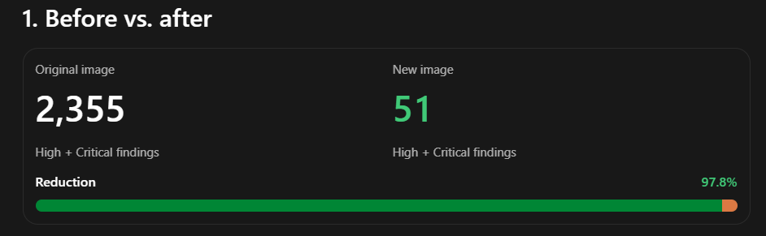

# Lab 5 — Container Image Security Scanning with Trivy

A Node.js application is scanned with Trivy, the findings are analyzed, the Dockerfile is hardened, and the image is scanned again to measure the improvement.

## Project Files

```
docker/lab5/
├── Dockerfile
├── app.js
├── package.json
├── results.html    # scan of trivy-lab:v1
├── results2.html   # scan of ivolve-app:v2
└── compare.png     # findings before vs after
```

---

## Part 1 — Scan the original image

The repository was cloned and the original image built:

```bash
docker build -t trivy-lab:v1 .
```

Trivy was run as a container, using the host Docker socket to inspect the local image:

```bash
docker run --rm \
  -v /var/run/docker.sock:/var/run/docker.sock \
  -v $HOME/.cache:/root/.cache \
  aquasec/trivy image trivy-lab:v1
```

An HTML report was generated with the same scan, limited to the two highest severities:

```bash
docker run --rm \
  -v /var/run/docker.sock:/var/run/docker.sock \
  -v $HOME/.cache:/root/.cache \
  -v $(pwd):/output \
  aquasec/trivy image \
  --severity CRITICAL,HIGH \
  --format template \
  --template "@contrib/html.tpl" \
  -o /output/results.html \
  trivy-lab:v1
```

The output was written to `results.html` and saved using the `/output` mount.

### Findings

| Severity | Count |
| --- | --- |
| CRITICAL | 222 |
| HIGH | 2133 |
| **Total** | **2355** |

### Root causes

1. **`node:18-bullseye`** — the image inherits Debian 11 system packages and Node.js 18, both past their normal security-maintenance lifetimes.
2. **`RUN npm install`** — without a lockfile, dependencies resolve differently across builds, so remediation is not reproducible.
3. **No runtime minimization** — a full Node.js Debian image ships utilities, libraries, and package-management tooling the app does not need.

---

## Part 2 — Harden the image

### Final Dockerfile

```dockerfile
FROM node:26.12.1-slim

ENV NODE_ENV=production

RUN apt-get update \
    && apt-get upgrade -y \
    && rm -rf /var/lib/apt/lists/*

WORKDIR /app

COPY package*.json ./

RUN if [ -f package-lock.json ]; then \
        npm ci --omit=dev --no-audit --no-fund; \
    else \
        npm install --omit=dev --no-audit --no-fund; \
    fi \
    && npm cache clean --force

COPY --chown=node:node app.js ./

USER node

EXPOSE 3000

CMD ["npm", "start"]
```

### What changed and why

- **Updated base image** — `node:26.12.1-slim` replaces the end-of-life `node:18-bullseye`, picking up a supported Node.js release and a maintained Debian base.
- **`ENV NODE_ENV=production`** — enables production behavior in Node.js libraries and keeps development-only dependencies out.
- **`apt-get update && apt-get upgrade`** — applies available patches to the OS packages inherited from the base image, and removes the downloaded lists to keep the layer small.
- **Production-only install** — `npm ci --omit=dev` is used when a lockfile exists for a clean, reproducible install; otherwise it falls back to `npm install --omit=dev`. The npm cache is cleared afterwards.
- **Non-root user** — the app is owned by and runs as the built-in `node` user via `COPY --chown=node:node` and `USER node`.

---

## Part 3 — Rebuild and rescan

```bash
docker build -t ivolve-app:v2 .

docker run --rm \
  -v /var/run/docker.sock:/var/run/docker.sock \
  -v $HOME/.cache:/root/.cache \
  -v $(pwd):/output \
  aquasec/trivy image \
  --severity CRITICAL,HIGH \
  --format template \
  --template "@contrib/html.tpl" \
  -o /output/results.html \
  ivolve-app:v2
```

The rescan was saved to `results2.html`.

## Results



| Image | CRITICAL + HIGH findings |
| --- | --- |
| `trivy-lab:v1` (original) | 2355 |
| `ivolve-app:v2` (hardened) | 51 |
| **Reduction** | **97.8%** |

## Conclusion

The remaining 51 findings come mainly from the base image's OS packages. Moving to a supported slim base, patching the OS layer, installing only production dependencies, and running as a non-root user removed over 97% of the original high and critical vulnerabilities.
