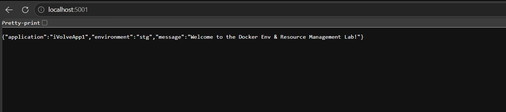
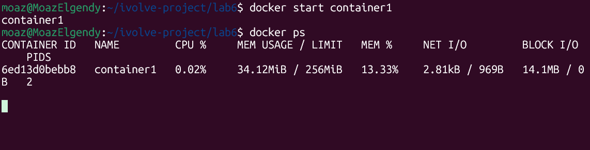
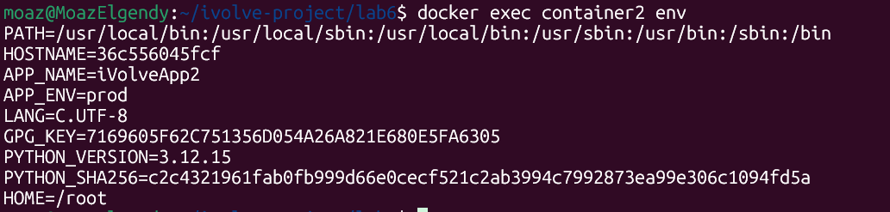
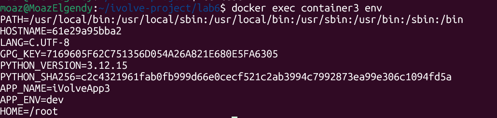

# Lab 6 — Docker Environment Variables & Resource Management

A Flask application is containerized and configured with environment variables in three different ways, then constrained with CPU and memory limits. The app reads `APP_NAME` and `APP_ENV`, refuses to start if either is missing, and returns them as JSON on port 5000.

## Project Files

```
docker/lab6/
├── Dockerfile
├── Dockerfile.env
├── app.py
├── requirements.txt
├── env.txt
├── localhost.png        # app response on port 5001
├── docker-stats.png     # container1 CPU / memory usage
├── container2-env.png   # env inside container2
└── container3-env.png   # env inside container3
```

---

## Part 1 — Environment variables with `-e`

### Dockerfile

```dockerfile
FROM python:3.12-slim

COPY requirements.txt .

RUN pip install --no-cache-dir -r requirements.txt

COPY . .

EXPOSE 5000

CMD ["python", "app.py"]
```

### Build and run

```bash
docker build -t ivolve1 .
docker run --name container1 -p 5001:5000 -e APP_NAME=iVolveApp1 -e APP_ENV=stg ivolve1
```

Port 5001 on the host is forwarded to port 5000 in the container, and the two `-e` flags inject the variables at runtime.



```
{"application":"iVolveApp1","environment":"stg","message":"Welcome to the Docker Env & Resource Management Lab!"}
```

### Verify the variables inside the container

```bash
docker exec container1 env
```

### Limit CPU and memory

```bash
docker update --cpus "1" --memory "256m" container1
```

```
Error response from daemon: Cannot update container ...: Memory limit should be smaller
than already set memoryswap limit, update the memoryswap at the same time
```

The container was created without explicit swap settings, so Docker applied default swap limits based on the host. The memory limit cannot be lowered below the existing swap limit on its own, so the swap value must be updated in the same command:

```bash
docker update --cpus "1" --memory "256m" --memory-swap -1 container1
```

`--memory-swap -1` leaves swap unlimited, which satisfies the relationship Docker enforces between the two limits.

### Verify the limits

```bash
docker stats container1
```



The container is capped at 256 MiB of memory (`26.44MiB / 256MiB` used) and one CPU, and answers normally under those limits.

---

## Part 2 — Environment variables with `--env-file`

### env.txt

```
APP_NAME=iVolveApp2

APP_ENV=prod
```

### Run with the file

```bash
docker run --name container2 -p 5002:5000 --env-file env.txt ivolve1
```

### Verify

```bash
docker exec container2 env
```



```
APP_NAME=iVolveApp2
APP_ENV=prod
```

---

## Part 3 — Environment variables hardcoded in the Dockerfile

### Dockerfile.env

```dockerfile
FROM python:3.12-slim

COPY requirements.txt .

RUN pip install --no-cache-dir -r requirements.txt

COPY . .

ENV APP_NAME=iVolveApp3 \
    APP_ENV=dev

EXPOSE 5000

CMD ["python", "app.py"]
```

### Build and run

```bash
docker build -t ivolve2 -f Dockerfile.env .
docker run --name container3 -p 5003:5000 ivolve2
```

### Verify

```bash
docker exec container3 env
```



```
APP_NAME=iVolveApp3
APP_ENV=dev
```

---

## Comparison of the three methods

| Method | Command | Values come from | Best used for |
| --- | --- | --- | --- |
| `-e` flags | `docker run -e APP_NAME=... -e APP_ENV=...` | Command line | Quick, one-off overrides |
| `--env-file` | `docker run --env-file env.txt` | An external file | Repeatable runs and separate per-environment config |
| `ENV` in Dockerfile | `ENV APP_NAME=... APP_ENV=...` | The image itself | Fixed defaults baked into the image |

## Notes

- `app.py` validates both variables and raises an error if either is missing, so a container started without them exits instead of serving a half-configured app.
- Ports 5001, 5002, and 5003 are used on the host so all three containers can run at the same time while each still listens on 5000 inside.
- `docker update` changes limits on a running container; the same flags can be passed to `docker run` to apply them at creation time.
