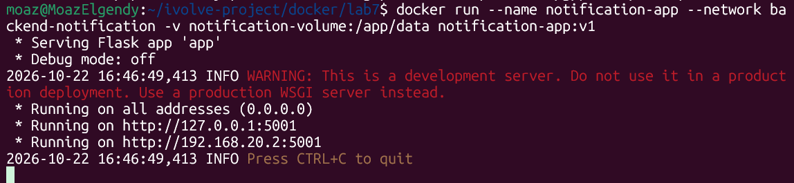
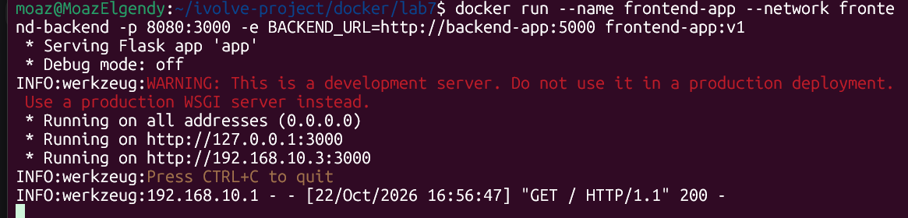
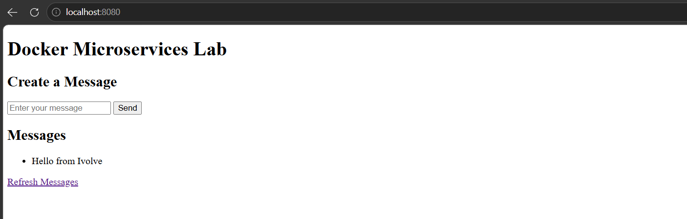

# Lab 7 — Docker Microservices: Networking & Volumes

Three Flask services are containerized and connected over two isolated bridge networks:

| Service | Port | Network(s) | Persistent storage |
| --- | --- | --- | --- |
| `frontend-app` | 3000 | `frontend-backend` | — |
| `backend-app` | 5000 | `frontend-backend`, `backend-notification` | messages (`/app/data`), logs (`/app/logs`) |
| `notification-app` | 5001 | `backend-notification` | logs (`/app/logs`) |

The frontend can only reach the backend, and the notification service is only reachable from the backend. Neither can see the other's network.

## Project Files

```
docker/lab7/
├── backend/
├── frontend/
├── notification/
├── backend-data/          # bind-mounted message data
├── notification-container.png
├── frontend-container.png
└── frontend-page.png
```

---

## Step 1 — Build the images

```bash
docker build -t backend-app:v1 backend/
docker build -t frontend-app:v1 frontend/
docker build -t notification-app:v1 notification/
```

## Step 2 — Create the networks

```bash
docker network create --subnet 192.168.10.0/24 --driver bridge frontend-backend
docker network create --subnet 192.168.20.0/24 --driver bridge backend-notification
```

- `frontend-backend` (`192.168.10.0/24`) — frontend ↔ backend.
- `backend-notification` (`192.168.20.0/24`) — backend ↔ notification.

## Step 3 — Create the volumes and data directory

```bash
docker volume create backend-volume
docker volume create notification-volume
mkdir -p backend-data
```

The backend stores its messages in `/app/data/messages.json` and writes its log to `/app/logs/backend.log`, so it needs both a bind mount for the data and a volume for the logs. `backend-data/` is the host directory used for the bind mount.

## Step 4 — Run the notification service

```bash
docker run --name notification-app \
  --network backend-notification \
  -v notification-volume:/app/data \
  notification-app:v1
```



The service starts on port 5001 and is attached only to `backend-notification` (`192.168.20.2`).

## Step 5 — Run the backend

```bash
docker run --name backend-app \
  --network backend-notification \
  --network frontend-backend \
  -v backend-volume:/app/logs \
  -v /home/moaz/ivolve-project/docker/lab7/backend-data/:/app/data \
  backend-app:v1
```

The backend is the only container on both networks, which is what lets it receive requests from the frontend and forward notifications to the notification service. The named volume persists the logs and the bind mount persists the messages on the host at `backend-data/messages.json`.

## Step 6 — Run the frontend

```bash
docker run --name frontend-app \
  --network frontend-backend \
  -p 8080:3000 \
  -e BACKEND_URL=http://backend-app:5000 \
  frontend-app:v1
```



`BACKEND_URL` points at the container name, which Docker's embedded DNS resolves on the shared network. Port 3000 in the container is published on host port 8080.

## Step 7 — Verify the application

Open `http://localhost:8080`.



The page lists the stored messages (`Hello from Ivolve`) and allows sending new ones. Submitting a message goes frontend → backend → `messages.json`, and the backend calls the notification service at `/notify`.

---

## How the pieces connect

```
Browser
   │  localhost:8080
   ▼
frontend-app  ── frontend-backend (192.168.10.0/24) ──►  backend-app
                                                            │
                                                            ├── /app/data  → backend-data/ (bind mount)
                                                            ├── /app/logs  → backend-volume
                                                            │
                                            backend-notification (192.168.20.0/24)
                                                            │
                                                            ▼
                                                    notification-app
                                                            └── /app/logs → notification-volume
```

## Notes

- The notification image writes its log to `/app/logs/notification.log`, so the volume for its logs should be mounted at `/app/logs` rather than `/app/data`.
- The backend defaults to `http://notification:5001/notify`, while the container is named `notification-app`. Adding `-e NOTIFICATION_URL=http://notification-app:5001/notify` to the backend run makes notifications resolve on `backend-notification`.
- Message storage survives container removal because it lives in the host directory `backend-data/`, not inside the container.
