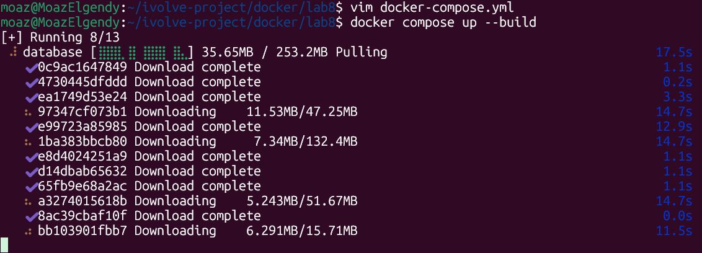
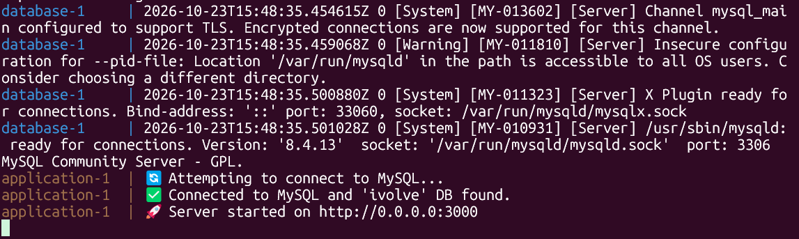
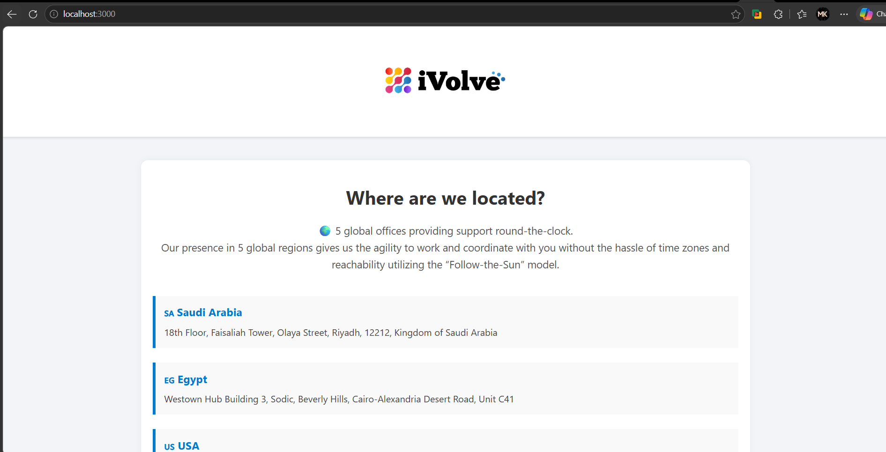
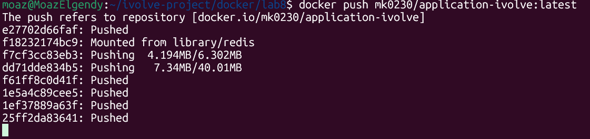

# Lab 8 — Docker Compose: Multi-Container Application

A Node.js application and a MySQL database are deployed together using Docker Compose. The application requires a MySQL connection and a database named `ivolve` to start successfully.

Docker Compose manages both services, their environment variables, persistent volumes, and communication through a custom bridge network.

| Service | Image | Port | Network | Persistent storage |
| --- | --- | --- | --- | --- |
| `application` | Built from Dockerfile | 3000 | `ivolve-net` | Application logs (`/app/logs`) |
| `database` | `mysql:8.4` | 3306 (internal) | `ivolve-net` | MySQL data (`/var/lib/mysql`) |

The application connects to MySQL using the database service name `database`, which Docker resolves through its internal DNS.

## Project Files

```text
docker/lab8/
├── Dockerfile
├── docker-compose.yml
├── README.md
├── compose-build.png
├── database-connection.png
├── application-page.png
└── dockerhub-push.png
```

---

## Step 1 — Create the Docker Compose file

Created a `docker-compose.yml` file to define the application and MySQL database services.

### docker-compose.yml

```yaml
services:
  application:
    build:
      context: .
      dockerfile: Dockerfile

    environment:
      - NODE_ENV=production
      - DB_HOST=database
      - DB_USER=mysql
      - DB_PASSWORD=mysql

    volumes:
      - application-volume:/app/logs

    networks:
      - ivolve-net

    ports:
      - "3000:3000"

    depends_on:
      database:
        condition: service_started

  database:
    image: mysql:8.4

    environment:
      - MYSQL_DATABASE=ivolve
      - MYSQL_USER=mysql
      - MYSQL_PASSWORD=mysql
      - MYSQL_ROOT_PASSWORD=root

    volumes:
      - database-volume:/var/lib/mysql

    networks:
      - ivolve-net

volumes:
  database-volume:
  application-volume:

networks:
  ivolve-net:
    driver: bridge
    ipam:
      config:
        - subnet: 192.168.10.0/24
```

The Compose file defines two services:

- **Application:** Built from the local Dockerfile, configured with database connection variables, and exposed on port 3000.
- **Database:** Uses MySQL 8.4 and creates the `ivolve` database with the configured credentials.

Both services are attached to the same custom network, `ivolve-net`.

## Step 2 — Configure persistent volumes

Two named Docker volumes are configured:

```yaml
volumes:
  database-volume:
  application-volume:
```

The application volume is mounted at `/app/logs`, while the database volume is mounted at `/var/lib/mysql`.

This allows application log files and MySQL database files to persist independently of the container lifecycle.

## Step 3 — Configure the custom network

Created a custom bridge network in the Compose configuration:

```yaml
networks:
  ivolve-net:
    driver: bridge
    ipam:
      config:
        - subnet: 192.168.10.0/24
```

The network uses the `192.168.10.0/24` subnet and allows communication between the application and database containers.

The application connects to MySQL using:

```text
DB_HOST=database
```

Docker Compose provides service-name resolution, so the application can reach MySQL through `database:3306` without exposing the database port to the host.

---

## Step 4 — Build and start the services

Started both services using Docker Compose:

```bash
docker compose up --build
```

Docker Compose pulls the MySQL image, builds the application image from the Dockerfile, creates the required network and volumes, and starts the containers.



The screenshot shows Docker Compose downloading the MySQL image layers during startup.

## Step 5 — Verify the database connection

After starting the services, checked the container logs to verify that MySQL initialized and the application connected successfully.

The database logs showed:

```text
/usr/sbin/mysqld: ready for connections.
Version: '8.4.13'
port: 3306
```

The application logs showed:

```text
🔄 Attempting to connect to MySQL...
✅ Connected to MySQL and 'ivolve' DB found.
🚀 Server started on http://0.0.0.0:3000
```



These logs confirm that:

- MySQL started and accepted connections.
- The application connected to MySQL successfully.
- The `ivolve` database was found.
- The application started listening on port 3000.

The Compose configuration uses `service_started`, which starts the application after the database container starts. It does not independently check database health.

## Step 6 — Verify the application in the browser

Opened the application at:

```text
http://localhost:3000
```



The iVolve website loaded successfully and displayed the company's global office locations.

This confirms that the application container is running and the port mapping from the host to the container is working correctly.

---

## Step 7 — Build and tag the application image

Built and tagged the application image using the Docker Hub username `mk0230`:

```bash
docker build -t mk0230/application-ivolve:latest .
```

The image name follows the Docker Hub repository format:

```text
<username>/<repository>:<tag>
```

The resulting image tag is:

```text
mk0230/application-ivolve:latest
```

## Step 8 — Push the image to Docker Hub

Pushed the tagged application image to Docker Hub:

```bash
docker push mk0230/application-ivolve:latest
```



The terminal output shows several image layers marked as `Pushed` and one layer mounted from `library/redis`, while other layers were still uploading when the screenshot was captured.

**Docker Hub Repository:**

[mk0230/application-ivolve](https://hub.docker.com/repository/docker/mk0230/application-ivolve/general)

---

## How the pieces connect

```text
                 Browser
                    |
             localhost:3000
                    |
                    v
             application
             (Node.js App)
                    |
                    | DB_HOST=database
                    | MySQL Port 3306
                    |
             ivolve-net
           192.168.10.0/24
                    |
                    v
                database
               (MySQL 8.4)
                    |
                    v
             ivolve Database
```

**Persistent storage:**

```text
application
    |
    └── /app/logs
          └── application-volume

database
    |
    └── /var/lib/mysql
          └── database-volume
```

## Notes

- Docker Compose manages the application and database as a multi-container deployment.
- The application uses the database service name `database` rather than `localhost` to connect to MySQL.
- The custom `ivolve-net` bridge network enables communication between both services.
- Named volumes persist application logs and database files when containers are recreated.
- The application is accessible through `http://localhost:3000`.
- The application logs confirm a successful MySQL connection and that the `ivolve` database exists.
- The application image is tagged as `mk0230/application-ivolve:latest` and was pushed to Docker Hub.
- The screenshot of the Docker Hub push captures an in-progress upload rather than the final digest confirmation.
- The database credentials are hardcoded for this lab. In a production environment, credentials should be stored securely using environment files or secrets.

