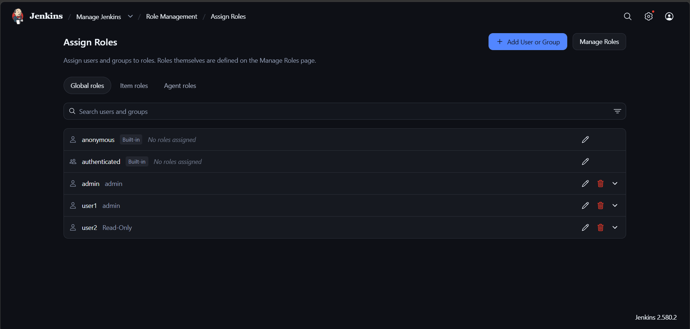
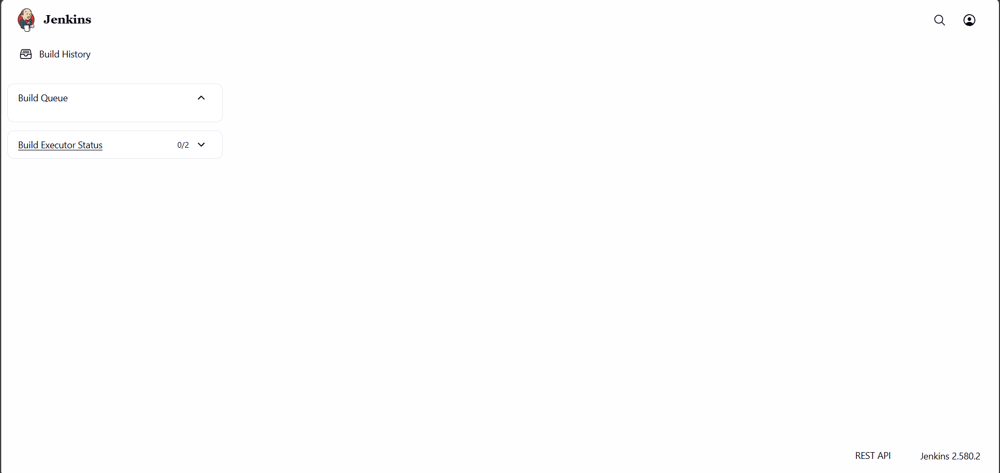

# Lab 20: Role-Based Access Control in Jenkins

## Objective

Create two users in Jenkins (`user1` and `user2`) and control their access using the **Role-Based Authorization Strategy** plugin:

- **user1** → assigned the `admin` role (full access)
- **user2** → assigned a `Read-Only` role (view-only access)

## Prerequisites

- A running Jenkins instance (Jenkins 2.580.2 used in this lab)
- An administrator account with access to **Manage Jenkins**

## Steps

### 1. Install the Role-Based Authorization Strategy plugin

1. Go to **Manage Jenkins → Plugins → Available plugins**.
2. Search for **Role-based Authorization Strategy**.
3. Select it and click **Install**, then restart Jenkins if required.

### 2. Enable role-based authorization

1. Go to **Manage Jenkins → Security**.
2. Under **Authorization**, select **Role-Based Strategy**.
3. Click **Save**.

### 3. Create the two users

1. Go to **Manage Jenkins → Users**.
2. Click **Create User**.
3. Create **user1** with a username, password, full name and email.
4. Repeat to create **user2**.

### 4. Define the roles

1. Go to **Manage Jenkins → Role Management → Manage Roles**.
2. Under **Global roles**, keep the default `admin` role (assigned to the built-in `admin` user) and add **user1** to it.
3. Add a new global role called **Read-Only** and grant it only the **Overall → Read** permission (plus optional view permissions).
4. Click **Save**.

### 5. Assign roles to the users

From **Role Management → Assign Roles** (Global roles tab):

- `user1` → **admin** role
- `user2` → **Read-Only** role

Both built-in groups (`anonymous` and `authenticated`) are left with no roles assigned.

**Assign Roles page showing the final role assignments:**

### 6. Verify the access levels

- Log in as **user1** — full admin access is available (Manage Jenkins, jobs, plugins, etc.).
- Log in as **user2** — only a limited, read-only dashboard is visible, with no way to create or modify jobs.

**user2's read-only view after logging in:**

## Notes

- Make sure the `admin` role assignment is saved **before** logging out, otherwise you can lock yourself out of Jenkins. If that happens, re-enable role-based settings from the Jenkins config files on the host.
