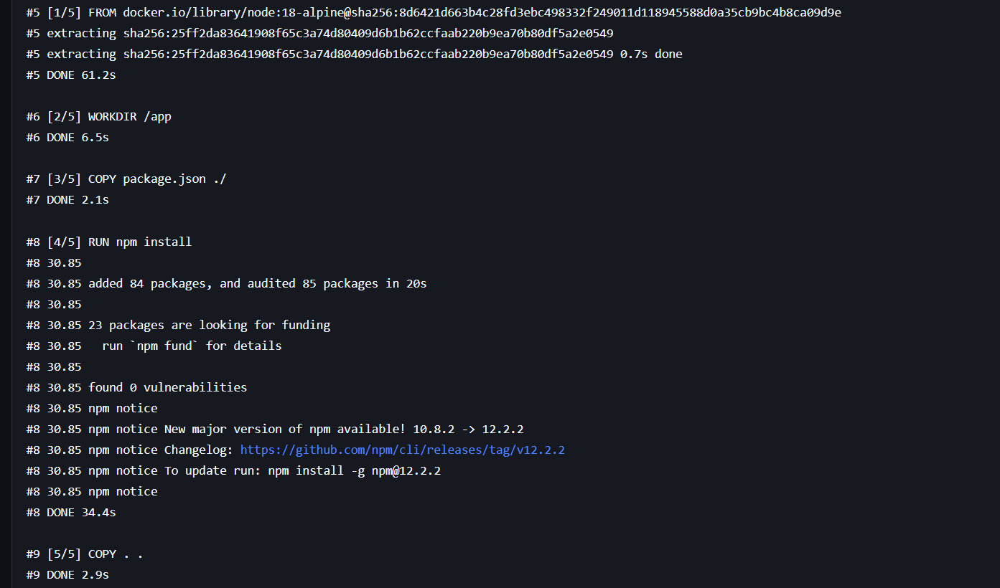
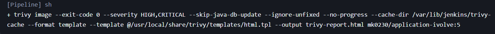
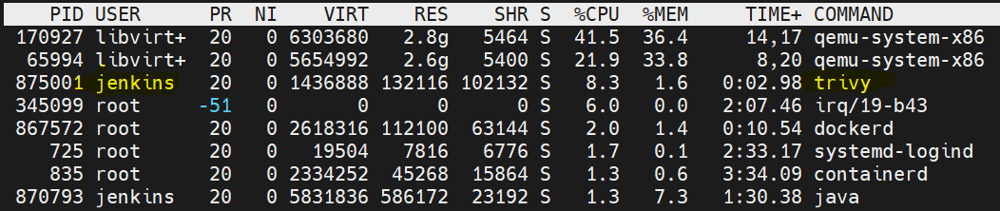
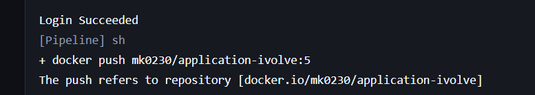
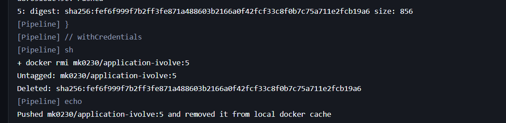
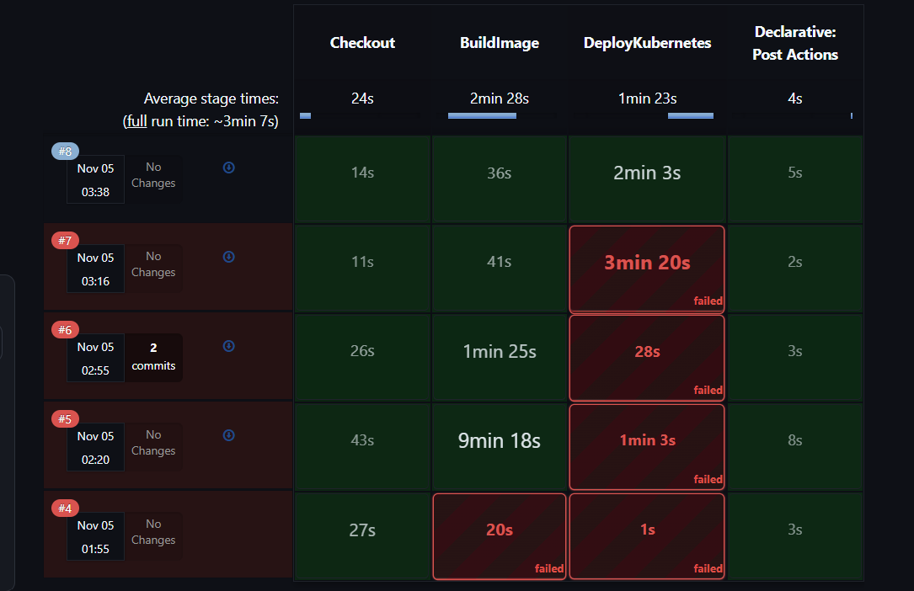

# Lab 21: Jenkins Declarative CI/CD Pipeline

## Objective

Design and execute an automated, end-to-end Declarative CI/CD Pipeline in Jenkins to build, scan, push a containerized Node.js application, and deploy it to a Kubernetes cluster.

Key requirements accomplished:
- Source code checkout and workspace staging using `stash` / `unstash`.
- Automated Docker image build tagged with the Jenkins `${BUILD_NUMBER}` (`mk0230/application-ivolve:${BUILD_NUMBER}`).
- Vulnerability scanning with **Trivy** and publishing an archived HTML scan report (`trivy-report.html`).
- Secure Docker Hub authentication and registry push using Jenkins credentials.
- Local Docker image cleanup to conserve disk space.
- Dynamic Kubernetes manifest patching (`kubernetes/lab15/app-deployment-ivolve.yaml`) with the new image tag.
- Deployment to the `ivolve` Kubernetes namespace and verification using `kubectl rollout status`.
- Structured post-build reporting and debugging hints.

---

## Prerequisites

- **Jenkins Controller & Agents**: Running Jenkins 2.x instance with distributed agent capability.
- **Plugins Installed**:
  - Pipeline / Declarative Pipeline
  - Git Plugin
  - Credentials Binding Plugin
- **Credentials Configured**:
  - `docker-hub`: **Username with password** credential for Docker Hub authentication.
  - `jenkins-kubeconfig`: **Secret file** credential containing cluster access configuration (`kubeconfig`).
- **Installed Tools on Agent Nodes**:
  - **Docker Engine & CLI**
  - **Trivy** CLI (with HTML template available at `/usr/local/share/trivy/templates/html.tpl` and cache directory `/var/lib/jenkins/trivy-cache`)
  - **kubectl** CLI
  - Standard utilities (`sed`, `grep`, `bash`)

---

## Pipeline Architecture & Configuration

The pipeline is defined in [Jenkinsfile](Jenkinsfile) and uses the Jenkins Shared Library `@Library('shared-lib') _`:

```groovy
@Library('shared-lib') _

pipeline{
    agent none

    options {
        skipDefaultCheckout(true)
    }

    environment{
        IMAGE_NAME = 'mk0230/application-ivolve'
        DOCKER_HUB_CREDENTIALS = 'docker-hub'
        DOCKERFILE_CONTEXT = './docker/lab8'
        MANIFEST_FILE = './kubernetes/lab15/app-deployment-ivolve.yaml'
        KUBE_CREDENTIALS = 'jenkins-kubeconfig'
        NAMESPACE = 'ivolve'
    }

    stages {
        stage('Checkout') {
            agent {label 'built-in'}
            steps {
                deleteDir()
                checkout scm
                stash name: 'source-files', includes: 'docker/lab8/**,kubernetes/lab15/app-deployment-ivolve.yaml'
            }
        }

        stage('BuildImage') {
            agent {label 'built-in'}
            steps {
                unstash 'source-files'
                script {
                    buildApp(env.IMAGE_NAME, env.DOCKER_HUB_CREDENTIALS, env.DOCKERFILE_CONTEXT)
                }
            }
        }

        stage('DeployKubernetes') {
            agent {label 'k8s-agent'}
            steps {
                unstash 'source-files'
                script {
                    deployKubernetes(env.IMAGE_NAME, env.MANIFEST_FILE, env.KUBE_CREDENTIALS, env.NAMESPACE)
                }
            }
        }
    }

    post {
        always {
            echo "______________________________________________________________________________"
            echo "Result:  ${currentBuild.currentResult}"
            echo "Job:     ${env.JOB_NAME} Build Number: ${env.BUILD_NUMBER}"
            echo "Image:   ${env.IMAGE_NAME}:${env.BUILD_NUMBER}"
            echo "Console: ${env.BUILD_URL}console"
        }
        success {
            echo "Deployed ${env.IMAGE_NAME}:${env.BUILD_NUMBER} to ${env.NAMESPACE}"
        }
        failure {
            echo "Pipeline failed at stage: ${env.STAGE_NAME}"
            echo "Debug: kubectl describe pods -n ${env.NAMESPACE}"
            echo "Debug: kubectl logs -n ${env.NAMESPACE} -l app=${env.IMAGE_NAME.tokenize('/')[-1]}"
        }
    }
}
```

### Environment Variables

| Variable | Value | Description |
| --- | --- | --- |
| `IMAGE_NAME` | `mk0230/application-ivolve` | Target Docker Hub repository and image name |
| `DOCKER_HUB_CREDENTIALS` | `docker-hub` | Jenkins credential ID for Docker Hub login |
| `DOCKERFILE_CONTEXT` | `./docker/lab8` | Relative path to Dockerfile and application source |
| `MANIFEST_FILE` | `./kubernetes/lab15/app-deployment-ivolve.yaml` | Kubernetes Deployment manifest to patch and apply |
| `KUBE_CREDENTIALS` | `jenkins-kubeconfig` | Jenkins credential ID for the kubeconfig file |
| `NAMESPACE` | `ivolve` | Target Kubernetes namespace |

---

## Pipeline Stages Breakdown

### 1. Checkout Stage
- **Agent**: `built-in`
- Wipes the workspace with `deleteDir()` to ensure build isolation.
- Clones repository using `checkout scm`.
- Stashes required build and deployment files (`docker/lab8/**`, `kubernetes/lab15/app-deployment-ivolve.yaml`) under the stash name `source-files` so downstream stages and agents can retrieve them.

### 2. BuildImage Stage
- **Agent**: `built-in`
- Restores files using `unstash 'source-files'`.
- Calls shared library step `buildApp`:
  1. Builds the Docker container image:
     ```bash
     docker build -t mk0230/application-ivolve:${BUILD_NUMBER} ./docker/lab8
     ```
  2. Scans the image with Trivy for `HIGH,CRITICAL` vulnerabilities and outputs an HTML report:
     ```bash
     trivy image --exit-code 0 --severity HIGH,CRITICAL --skip-java-db-update \
         --ignore-unfixed --no-progress --cache-dir /var/lib/jenkins/trivy-cache \
         --format template --template "@/usr/local/share/trivy/templates/html.tpl" \
         --output trivy-report.html ${image}
     ```
  3. Archives `trivy-report.html` as a Jenkins build artifact.
  4. Authenticates to Docker Hub securely using `withCredentials` and pushes the tag:
     ```bash
     echo "$DOCKER_PASS" | docker login -u "$DOCKER_USER" --password-stdin
     docker push mk0230/application-ivolve:${BUILD_NUMBER}
     ```
  5. Cleans up the image locally using `docker rmi`.

### 3. DeployKubernetes Stage
- **Agent**: `k8s-agent`
- Restores files on the target agent using `unstash 'source-files'`.
- Calls shared library step `deployKubernetes`:
  1. Injects kubeconfig securely via `withCredentials([file(...)])`.
  2. Dynamically updates the image tag inside the deployment manifest using `sed`:
     ```bash
     sed -i 's|^\([[:space:]]*\(-[[:space:]]*\)\?image:[[:space:]]*\)'${IMAGE_NAME}'.*|\1'${IMAGE_NAME}:${BUILD_NUMBER}'|' '${MANIFEST_FILE}'
     ```
  3. Validates the substitution with `grep`.
  4. Applies the deployment manifest to Kubernetes:
     ```bash
     kubectl apply -f ./kubernetes/lab15/app-deployment-ivolve.yaml -n ivolve
     ```
  5. Waits for the rollout to complete successfully (timeout: 180s):
     ```bash
     kubectl rollout status -f ./kubernetes/lab15/app-deployment-ivolve.yaml -n ivolve --timeout=180s
     ```

### 4. Post-Execution Actions
- **always**: Prints build status, build number, image tag, and console URL.
- **success**: Echoes deployment confirmation.
- **failure**: Outputs diagnostic commands (`kubectl describe pods` and `kubectl logs`).

---

## Execution Screenshots

### 1. Docker Image Build
Docker image layers being built and dependencies installed via npm:



### 2. Trivy Vulnerability Scan
Trivy scanning the generated container image (`mk0230/application-ivolve:5`) for high and critical vulnerabilities and producing an HTML report:



### 3. System Process Monitoring (Trivy Scan)
Monitoring node resource usage using `top`, showing the `jenkins` user actively running `trivy`:



### 4. Docker Hub Login & Image Push
Authenticating against Docker Hub registry and initiating image push:



### 5. Docker Push Confirmation & Local Cleanup
Docker push completion with SHA256 digest and removal of the local image tag via `docker rmi`:



### 6. Pipeline Execution Stage View
Jenkins Stage View showing successful execution of **Build #8** across all pipeline stages (**Checkout**, **BuildImage**, and **DeployKubernetes**):


