# Lab 22: Jenkins Distributed Agents (Nodes) & Shared Library

## Objective

Modernize and scale the Jenkins CI/CD infrastructure by decoupling pipeline logic into a reusable **Jenkins Shared Library** (`shared-lib`) and executing pipeline stages across **Distributed Agents (Nodes)**:

1. **Shared Library Implementation (`shared-lib`)**:
   - Encapsulate application build, security scanning, and registry push into `vars/buildApp.groovy`.
   - Encapsulate Kubernetes manifest templating, deployment, and rollout validation into `vars/deployKubernetes.groovy`.
2. **Distributed Agent Architecture**:
   - Segregate build workloads by executing compilation, image building, and vulnerability scanning on the `built-in` agent.
   - Execute cluster deployment on a dedicated `k8s-agent` node equipped with cluster network connectivity and `kubectl`.
3. **Artifact Stashing across Agents**:
   - Utilize Jenkins `stash` and `unstash` mechanisms to share files between nodes without requiring shared persistent storage.
4. **End-to-End Validation**:
   - Verify published Docker Hub tags and live deployment updates on Kubernetes via a web browser.

---

## Directory Structure

```text
lab22/
├── vars/
│   ├── buildApp.groovy                  # Shared library step for building, scanning, and pushing Docker image
│   └── deployKubernetes.groovy          # Shared library step for updating manifest and deploying to K8s
├── shared-lib-buildApp.png              # Shared library implementation of buildApp
├── shared-lib-deployKubernetes.png      # Shared library implementation of deployKubernetes
├── jenkinsfile-shared-lib-agents.png    # Jenkinsfile utilizing shared library & multi-agent allocation
├── jenkins-nodes-status.png             # Jenkins Node Management dashboard with online distributed nodes
├── docker-build.png                     # Docker image build execution on built-in agent
├── trivy-scan.png                       # Trivy security scanning execution
├── trivy-process.png                    # System process monitoring (top) during Trivy scan
├── docker-push.png                      # Docker Hub login and image push
├── docker-cleanup.png                   # Image digest confirmation and local docker cleanup
├── docker-hub-tags.png                  # Remote Docker Hub registry tags verification
├── pipeline-stage-view.png              # Jenkins Stage View of end-to-end multi-node pipeline execution (Build #10)
└── k8s-app-browser-verification.png     # Live web application browser verification on Kubernetes
```

---

## Shared Library Implementation

The library is configured in Jenkins under **Manage Jenkins → System → Global Pipeline Libraries** as `shared-lib`.

### 1. `vars/buildApp.groovy`

Located at [vars/buildApp.groovy](vars/buildApp.groovy):

```groovy
def call(String imageName, String dockerCredsId, String contextDir = '.') {
    def image = "${imageName}:${env.BUILD_NUMBER}"

    echo "Building ${image}"
    sh "docker build -t ${image} ${contextDir}"

    echo "Scanning ${image} for vulnerabilities using trivy (non-blocking)"
    sh """
        trivy image --exit-code 0 --severity HIGH,CRITICAL --skip-java-db-update \
        --ignore-unfixed --no-progress --cache-dir /var/lib/jenkins/trivy-cache \
        --format template --template "@/usr/local/share/trivy/templates/html.tpl" \
        --output trivy-report.html ${image}
    """
    archiveArtifacts artifacts: 'trivy-report.html', allowEmptyArchive: true

    withCredentials([usernamePassword(
        credentialsId: dockerCredsId,
        usernameVariable: 'DOCKER_USER',
        passwordVariable: 'DOCKER_PASS'
    )]) {
        sh 'echo "$DOCKER_PASS" | docker login -u "$DOCKER_USER" --password-stdin'
        sh "docker push ${image}"
    }

    sh "docker rmi ${image} || true"
    echo "Pushed ${image} and removed it from local docker cache"
}
```

#### Step Functions & Parameters:
- **`imageName`**: Docker image repository (e.g., `mk0230/application-ivolve`).
- **`dockerCredsId`**: Jenkins credential ID (`docker-hub`).
- **`contextDir`**: Path to Docker context directory (defaults to `.`).
- **Build**: Builds Docker container tagged dynamically with `${env.BUILD_NUMBER}`.
- **Security Scan**: Executes Trivy against the local image targeting `HIGH` and `CRITICAL` issues using non-blocking mode (`--exit-code 0`), caching database to `/var/lib/jenkins/trivy-cache`, and formatting output as HTML using an HTML template.
- **Archive**: Archives `trivy-report.html` as a permanent Jenkins build artifact.
- **Push**: Injects Docker credentials using `withCredentials([usernamePassword(...)])`, logs in securely via stdin, and pushes the image.
- **Cleanup**: Removes the local Docker image via `docker rmi` to prevent disk bloat.

---

### 2. `vars/deployKubernetes.groovy`

Located at [vars/deployKubernetes.groovy](vars/deployKubernetes.groovy):

```groovy
def call(String imageName, String manifestPath, String kubeCredentialsId, String namespace) {
    def image = "${imageName}:${env.BUILD_NUMBER}"

    withCredentials([file(credentialsId: kubeCredentialsId, variable: 'KUBECONFIG')]) {
        echo "Updating ${manifestPath} to ${image}"

        sh """
            sed -i 's|^\\([[:space:]]*\\(-[[:space:]]*\\)\\?image:[[:space:]]*\\)${imageName}.*|\\1${image}|' '${manifestPath}'
            grep -Eq '^[[:space:]]*(-[[:space:]]*)?image:[[:space:]]*${image}[[:space:]]*\$' '${manifestPath}' || {
                echo "image not updated"
                exit 1
            }
        """
        sh "kubectl apply -f '${manifestPath}' -n '${namespace}'"
        sh "kubectl rollout status -f '${manifestPath}' -n '${namespace}' --timeout=180s"
    }
}
```

#### Step Functions & Parameters:
- **`imageName`**: Target Docker image prefix.
- **`manifestPath`**: Path to Kubernetes YAML manifest.
- **`kubeCredentialsId`**: Jenkins Secret File credential ID containing the `kubeconfig` (`jenkins-kubeconfig`).
- **`namespace`**: Destination Kubernetes namespace (`ivolve`).
- **Manifest Templating**: Uses regular expressions with `sed -i` to update the deployment image tag to `${imageName}:${BUILD_NUMBER}` in-place, then validates substitution using `grep -Eq`.
- **Deployment**: Deploys via `kubectl apply -f ... -n ...`.
- **Verification**: Tracks rollout progression with `kubectl rollout status` within a 180-second timeout window.

---

## Distributed Agent Architecture & Integration

The pipeline coordinates multiple nodes by setting top-level `agent none` and assigning specific labels per stage:

```groovy
@Library('shared-lib') _

pipeline{
    agent none

    options {
        skipDefaultCheckout(true)
    }

    environment{
        IMAGE_NAME = 'mk0230/application-ivolve'
        DOCKER_HUB_CREDENTIALS = 'docker-hub'
        DOCKERFILE_CONTEXT = './docker/lab8'
        MANIFEST_FILE = './kubernetes/lab15/app-deployment-ivolve.yaml'
        KUBE_CREDENTIALS = 'jenkins-kubeconfig'
        NAMESPACE = 'ivolve'
    }

    stages {
        stage('Checkout') {
            agent {label 'built-in'}
            steps {
                deleteDir()
                checkout scm
                stash name: 'source-files', includes: 'docker/lab8/**,kubernetes/lab15/app-deployment-ivolve.yaml'
            }
        }

        stage('BuildImage') {
            agent {label 'built-in'}
            steps {
                unstash 'source-files'
                script {
                    buildApp(env.IMAGE_NAME, env.DOCKER_HUB_CREDENTIALS, env.DOCKERFILE_CONTEXT)
                }
            }
        }

        stage('DeployKubernetes') {
            agent {label 'k8s-agent'}
            steps {
                unstash 'source-files'
                script {
                    deployKubernetes(env.IMAGE_NAME, env.MANIFEST_FILE, env.KUBE_CREDENTIALS, env.NAMESPACE)
                }
            }
        }
    }
    ...
}
```

### Node Responsibilities

| Node / Label | Purpose & Tools | Executed Stages |
| --- | --- | --- |
| **`built-in`** | Host controller with Docker Engine, Git, and Trivy scanner | `Checkout`, `BuildImage` |
| **`k8s-agent`** | Dedicated worker node with `kubectl` and access to Kubernetes cluster network | `DeployKubernetes` |

### Inter-Node File Sharing
Because stages run on distinct agent nodes (`built-in` vs `k8s-agent`), workspaces are isolated:
1. In `Checkout` on `built-in`, required files are saved with:
   ```groovy
   stash name: 'source-files', includes: 'docker/lab8/**,kubernetes/lab15/app-deployment-ivolve.yaml'
   ```
2. In subsequent stages on `built-in` and `k8s-agent`, files are restored with:
   ```groovy
   unstash 'source-files'
   ```

---

## Verification & Screenshots

### 1. Shared Library Code: `buildApp.groovy`
Implementation of `buildApp.groovy` in VS Code:

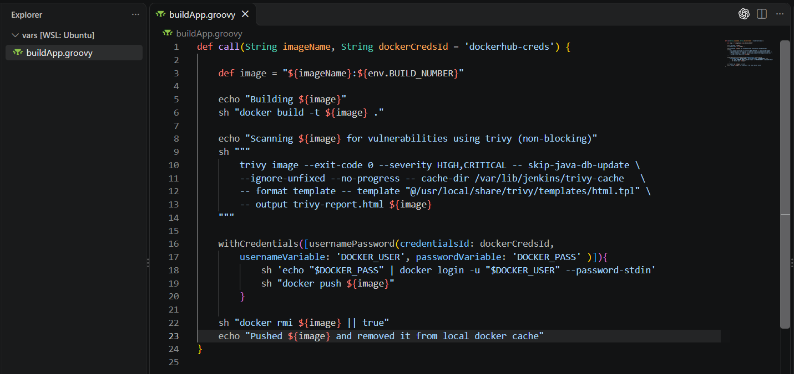

### 2. Shared Library Code: `deployKubernetes.groovy`
Implementation of `deployKubernetes.groovy` in VS Code:

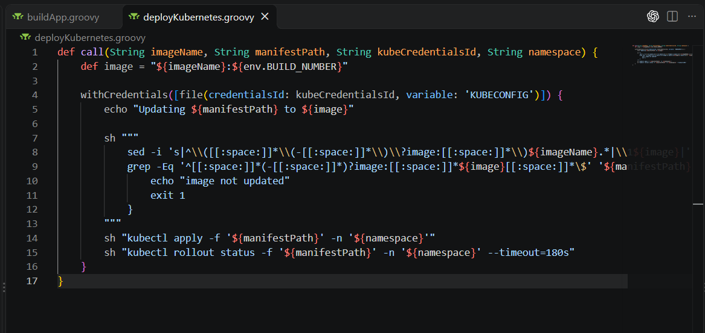

### 3. Pipeline Configuration with Shared Library & Distributed Agents
The `Jenkinsfile` consuming `@Library('shared-lib')` and assigning stages to `built-in` and `k8s-agent`:

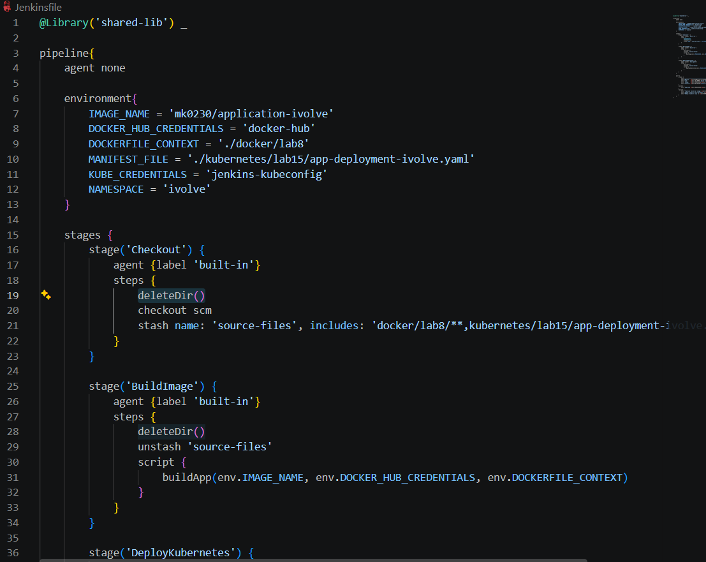

### 4. Distributed Jenkins Agent Nodes Status
Jenkins Node Management dashboard showing both the `Built-In Node` (controller) and `k8s-agent` (worker node) active, synchronized, and connected:

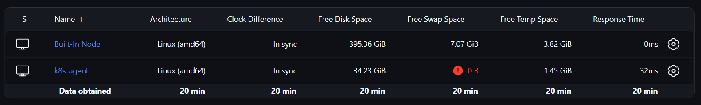

### 5. Docker Build Execution (`built-in` agent)
Building the container image on the `built-in` node:

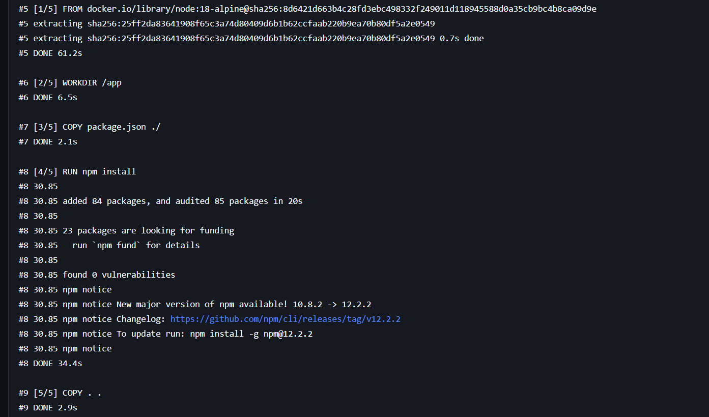

### 6. Trivy Security Scan Execution
Scanning the newly built image for vulnerabilities using Trivy:

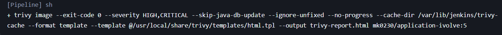

### 7. Process Monitoring during Trivy Scan
Verifying Trivy execution under the `jenkins` user process on the host:

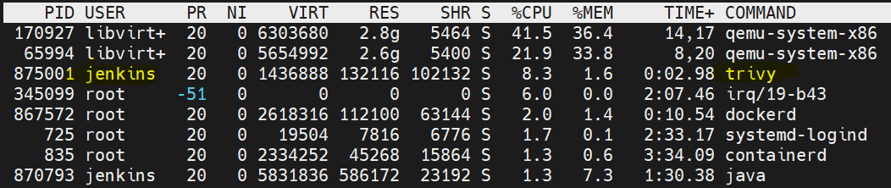

### 8. Docker Hub Authentication & Image Push
Logging into Docker Hub and pushing the tagged image:

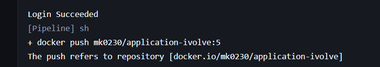

### 9. Image Digest Confirmation & Local Cache Cleanup
Confirming successful push and local image deletion (`docker rmi`):

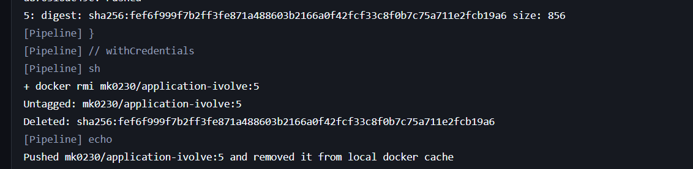

### 10. Docker Hub Repository Tags Verification
Verifying the newly published image tags (up to tag `10`) in the remote Docker Hub repository (`mk0230/application-ivolve`):

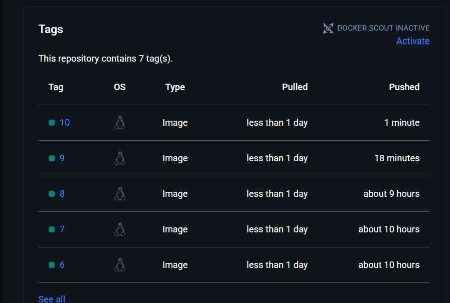

### 11. End-to-End Multi-Node Pipeline Stage View
Jenkins Stage View showing consecutive successful executions (**Build #8**, **Build #9**, and **Build #10**) across all distributed stages (**Checkout**, **BuildImage**, and **DeployKubernetes**):

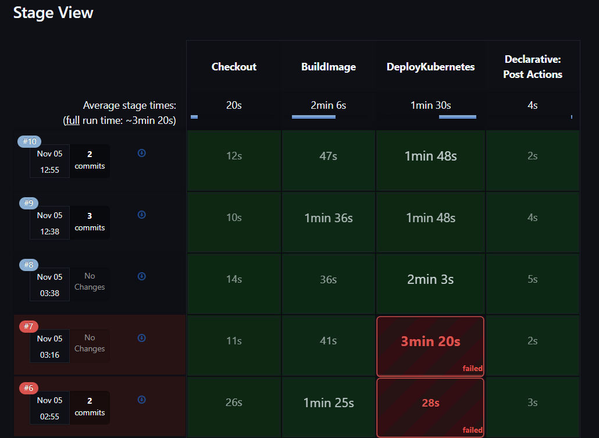

### 12. Application Rollout & Live Web Browser Verification
Accessing the application live via Kubernetes NodePort service at `http://192.168.1.5:3010`, confirming that the latest changes ("Westown Hub Building 3, Sodic, Beverly Hills, Cairo-Alexandria Desert Road, Unit C41, Jenkins") were deployed and served successfully:

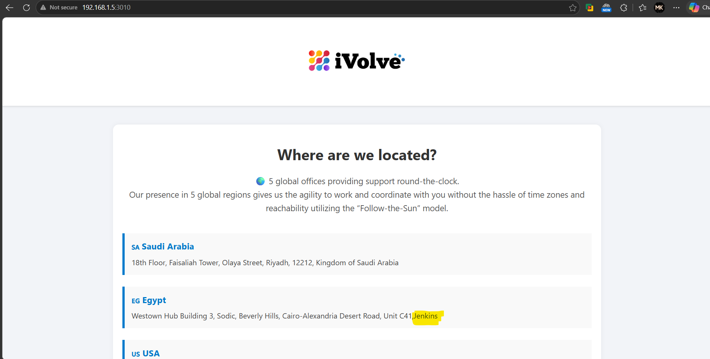
