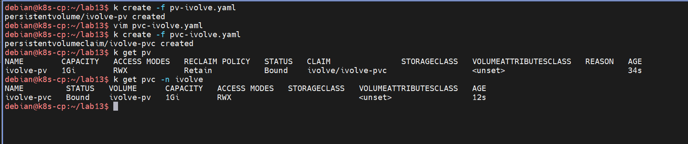

# Lab 13 — Persistent Volumes and Persistent Volume Claims

Provide durable storage for pods with a `PersistentVolume` backed by a `hostPath`, then claim it from the `ivolve` namespace with a `PersistentVolumeClaim`.

| Item | Value |
|---|---|
| PersistentVolume | `ivolve-pv` (cluster-scoped) |
| PersistentVolumeClaim | `ivolve-pvc` in `ivolve` |
| Capacity | `1Gi` |
| Backing path | `/mnt/app-logs` on the node |
| Access mode | `ReadWriteMany` |
| Reclaim policy | `Retain` |

The screenshots use `k` as an alias for `kubectl`.

## Step 1 — The PV manifest

```yaml
apiVersion: v1
kind: PersistentVolume
metadata:
  name: ivolve-pv
spec:
  capacity:
    storage: 1Gi
  accessModes:
    - ReadWriteMany
  persistentVolumeReclaimPolicy: Retain
  storageClassName: ""
  hostPath:
    path: /mnt/app-logs
    type: DirectoryOrCreate
```

Key fields:

- `hostPath` with `DirectoryOrCreate` — the node creates `/mnt/app-logs` if it does not exist. This is lab-only storage; real clusters use NFS, cloud disks, etc.
- `retentionPolicy: Retain` — after the claim is deleted, the volume and its data are kept instead of being wiped (`Delete`) or released for reuse (`Recycle`, deprecated).
- `storageClassName: ""` — no StorageClass, so the cluster cannot match this PV to a claim dynamically. The claim must point at it by name, which Step 3 does.
- `accessModes: ReadWriteMany` — the volume can be mounted read-write by many nodes at once.

A PV is a cluster resource, like a Node — it lives outside any namespace.

## Step 2 — The PVC manifest

```yaml
apiVersion: v1
kind: PersistentVolumeClaim
metadata:
  name: ivolve-pvc
  namespace: ivolve
spec:
  accessModes:
    - ReadWriteMany
  resources:
    requests:
      storage: 1Gi
  storageClassName: ""
  volumeName: ivolve-pv
```

Unlike the PV, a PVC is namespaced — it belongs to one namespace, here `ivolve` from Lab 11. The request (`1Gi`, `ReadWriteMany`) is a filter the cluster matches against available volumes; `volumeName: ivolve-pv` plus `storageClassName: ""` pins the claim statically to exactly that volume, skipping the scheduler's normal binding logic.

## Step 3 — Create and bind

```bash
k create -f pv-ivolve.yaml
k create -f pvc-ivolve.yaml
```



Expected output:

```
persistentvolume/ivolve-pv created
persistentvolumeclaim/ivolve-pvc created
```

## Step 4 — Verify the binding

```bash
k get pv
k get pvc -n ivolve
```


The volume table shows `ivolve-pv  1Gi  RWX  Retain  Bound  ivolve/ivolve-pvc` — the `CLAIM` column names the claim that captured it, including its namespace. The claim table shows `ivolve-pvc  Bound  ivolve-pv  1Gi  RWX`, pointing back at its volume.

`Bound` in both directions means the PV is now reserved: no other PVC can bind to `ivolve-pv` while this claim holds it.

## Result

A `1Gi` host-backed volume exists at `/mnt/app-logs` on the node, statically bound to `ivolve-pvc` in the `ivolve` namespace. Pods consume it with a `volumes` entry that references `claimName: ivolve-pvc`; with `ReadWriteMany`, several pods can mount it at the same time. Because the reclaim policy is `Retain`, deleting the claim does not delete the volume or its data — the PV stays `Released` until an administrator cleans `/mnt/app-logs` and reclaims it manually.

## Files

| File | Contents |
|---|---|
| `pv-ivolve.yaml` | `PersistentVolume` manifest, hostPath `/mnt/app-logs`, `Retain` |
| `pvc-ivolve.yaml` | `PersistentVolumeClaim` manifest, statically bound via `volumeName` |

## Cleanup

```bash
kubectl delete pvc ivolve-pvc -n ivolve
kubectl delete pv ivolve-pv
```

Delete the claim first so the PV is released; with `Retain`, the PV moves to `Released` rather than straight to `Available`, keeping `/mnt/app-logs` intact.
