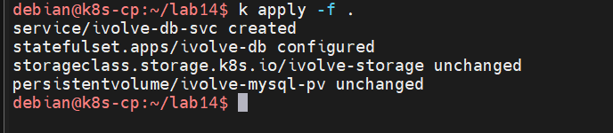

# Lab 14 — StatefulSets, Headless Services and StorageClasses

Run MySQL under a `StatefulSet` in the `ivolve` namespace, backed by a `StorageClass` and a `local` PersistentVolume so its data survives pod restarts.

| Object | Name | Notes |
|---|---|---|
| StorageClass | `ivolve-storage` | `no-provisioner`, `WaitForFirstConsumer`, `Retain` |
| PersistentVolume | `ivolve-mysql-pv` | `5Gi`, `ReadWriteOnce`, local path `/mnt/mysql-data` on `k8s-worker` |
| Headless Service | `ivolve-db-svc` | `clusterIP: None`, port `3306` |
| StatefulSet | `ivolve-db` | `mysql` image, 1 replica, `1Gi` volume claim template |

The screenshots use `k` as an alias for `kubectl`.

## Step 1 — The StorageClass

```yaml
apiVersion: storage.k8s.io/v1
kind: StorageClass
metadata:
  name: ivolve-storage
provisioner: kubernetes.io/no-provisioner
volumeBindingMode: WaitForFirstConsumer
reclaimPolicy: Retain
```

Key fields:

- `provisioner: kubernetes.io/no-provisioner` — the class does not create volumes itself. PVs must already exist (Step 2); the class only defines how claims bind to them.
- `volumeBindingMode: WaitForFirstConsumer` — the PVC stays `Pending` until a pod actually uses it. The scheduler then picks a PV on the same node as the pod, which matters for `local` volumes that only exist on one node.
- `reclaimPolicy: Retain` — deleting the claim keeps the volume and its data, as in Lab 13.

## Step 2 — The local PersistentVolume

```yaml
apiVersion: v1
kind: PersistentVolume
metadata:
  name: ivolve-mysql-pv
spec:
  capacity:
    storage: 5Gi
  accessModes:
    - ReadWriteOnce
  persistentVolumeReclaimPolicy: Retain
  storageClassName: ivolve-storage
  local:
    path: /mnt/mysql-data
  nodeAffinity:
    required:
      nodeSelectorTerms:
        - matchExpressions:
            - key: kubernetes.io/hostname
              operator: In
              values:
                - k8s-worker
```

Compared with the `hostPath` PV of Lab 13:

- `local` instead of `hostPath` — kubelet enforces the path must exist and be a real directory/mount, and the volume is not usable from arbitrary nodes. `nodeAffinity` is therefore **required**, not optional: it pins the PV to `k8s-worker` so the scheduler knows where the storage physically lives.
- `storageClassName: ivolve-storage` — unlike Lab 13's `""`, the PV belongs to the class from Step 1, so it can be matched dynamically to a claim requesting that class.

## Step 3 — The headless Service

```yaml
apiVersion: v1
kind: Service
metadata:
  name: ivolve-db-svc
  namespace: ivolve
spec:
  clusterIP: None
  selector:
    app: db
  ports:
    - name: mysql
      port: 3306
      targetPort: 3306
```

`clusterIP: None` makes it headless: no virtual IP, no load balancing. Instead, DNS resolves straight to the IP of each pod matching `app: db`. StatefulSet databases need this because clients connect to specific instances (primaries, replicas) by name, not to a rotating proxy.

## Step 4 — The StatefulSet

```yaml
apiVersion: apps/v1
kind: StatefulSet
metadata:
  name: ivolve-db
  namespace: ivolve
spec:
  replicas: 1
  serviceName: ivolve-db
  selector:
    matchLabels:
      app: db
  template:
    metadata:
      name: mysql
      labels:
        app: db
    spec:
      nodeSelector:
        project: ivolve
      tolerations:
        - key: workload
          operator: Equal
          value: ivolveApp
          effect: NoSchedule
      containers:
        - image: mysql
          name: mysql-container
          ports:
            - containerPort: 3306
          env:
            - name: MYSQL_ROOT_PASSWORD
              valueFrom:
                secretKeyRef:
                  name: ivolve-secret
                  key: MY_SQL_ROOT_PASSWORD
            - name: MYSQL_USER
              valueFrom:
                configMapKeyRef:
                  name: ivolve-cm
                  key: DB_USER
            - name: MYSQL_PASSWORD
              valueFrom:
                secretKeyRef:
                  name: ivolve-secret
                  key: DB_PASSWORD
          volumeMounts:
            - name: mysql-data
              mountPath: /var/lib/mysql
  volumeClaimTemplates:
    - metadata:
        name: mysql-data
      spec:
        resources:
          requests:
            storage: 1Gi
        accessModes:
          - ReadWriteOnce
        storageClassName: ivolve-storage
```

What makes this a StatefulSet rather than a Deployment:

- Pods get stable, ordered names — this replica is `ivolve-db-0`, and it keeps that identity across rescheduling.
- `volumeClaimTemplates` gives each pod its own PVC (`mysql-data-ivolve-db-0`), created lazily when the pod appears. Deleting the pod deletes neither the PVC nor the PV; the recreated `ivolve-db-0` remounts the same volume with the database intact.
- `serviceName` declares the governing headless service. Note the mismatch: the service is `ivolve-db-svc` but the field says `ivolve-db`, so the StatefulSet is not actually governed by it. Rename one of them (e.g. `serviceName: ivolve-db-svc`) so per-pod DNS identities come from the headless service.
- `nodeSelector: project=ivolve` and the `workload` toleration (Lab 10) are required because the PV lives on `k8s-worker`, which is tainted and labelled for this project. The pod, the PV's `nodeAffinity` and the `WaitForFirstConsumer` binding mode must all agree on the same node.
- The `env` values come from Lab 12's `ivolve-cm` and `ivolve-secret`, keeping credentials out of the manifest.

## Step 5 — Apply everything

From the lab directory, apply all manifests at once:

```bash
k apply -f .
```



Expected output:

```
service/ivolve-db-svc created
statefulset.apps/ivolve-db configured
storageclass.storage.k8s.io/ivolve-storage unchanged
persistentvolume/ivolve-mysql-pv unchanged
```

The `unchanged` lines show the StorageClass and PV were already applied earlier; `apply` reconciles declaratively instead of failing on existing objects, the way `create` did in Lab 12.

Because `ivolve-storage` uses `WaitForFirstConsumer`, the PVC from the volume claim template stays `Pending` and the PV `Available` until `ivolve-db-0` is scheduled — then the claim binds to `ivolve-mysql-pv` and the pod mounts it at `/var/lib/mysql`.

## Result

MySQL runs as `ivolve-db-0` on `k8s-worker` in the `ivolve` namespace, fronted by the headless `ivolve-db-svc`, with a `Retain`-policy volume persisting its data. Its config and credentials come from the ConfigMap and Secret of Lab 12, and its storage is delivered through a StorageClass rather than a hand-pinned claim like Lab 13. The chain — class, local PV with node affinity, claim template, headless service — is the pattern a real database operator (e.g. a MySQL or PostgreSQL operator via a CSI driver) builds on.

## Files

| File | Contents |
|---|---|
| `storageClass-ivolve.yaml` | StorageClass `ivolve-storage`, `no-provisioner`, `WaitForFirstConsumer` |
| `storageClass-pv-ivolve.yaml` | `5Gi` local PV pinned to `k8s-worker` via `nodeAffinity` |
| `headless-service-ivolve.yaml` | Headless Service `ivolve-db-svc`, `clusterIP: None` |
| `stateful-set-ivolve.yaml` | StatefulSet with volume claim template, env refs, taint tolerations |

## Cleanup

```bash
kubectl delete statefulset ivolve-db -n ivolve
kubectl delete service ivolve-db-svc -n ivolve
kubectl delete pvc mysql-data-ivolve-db-0 -n ivolve
kubectl delete pv ivolve-mysql-pv
kubectl delete storageclass ivolve-storage
```

Deleting the StatefulSet removes the pod but not its claim — PVCs from a volume claim template must be deleted explicitly. With `Retain`, the PV then sits in `Released` until `/mnt/mysql-data` is cleaned up manually.
