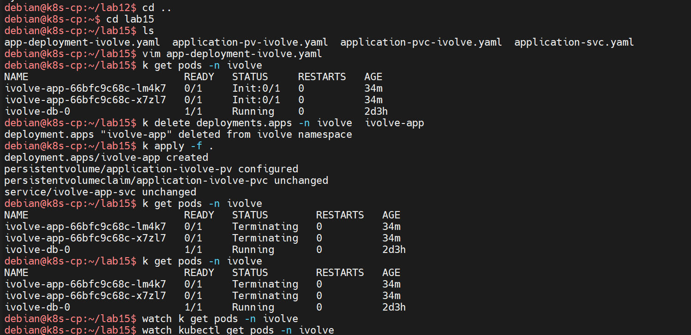

# Lab 15 — Deployment, Init Container, Persistent Storage and Service

Run the `ivolve-app` application as a two-replica Deployment in `ivolve`, wait for MySQL with an init container, persist its logs on a `2Gi` volume, and expose it inside the cluster with a `ClusterIP` Service.

| Object | Name | Notes |
|---|---|---|
| Deployment | `ivolve-app` | 2 replicas, image `mk0230/application-ivolve`, port `3000` |
| Init container | `init-mysql` | waits for MySQL, creates the `ivolve` database |
| PersistentVolume | `application-ivolve-pv` | `2Gi`, `ReadWriteMany`, hostPath `/app/logs` |
| PersistentVolumeClaim | `application-ivolve-pvc` | `2Gi`, statically bound to the PV |
| Service | `ivolve-app-svc` | `ClusterIP`, port `3000` → `3000` |

Prerequisites from earlier labs: the `ivolve` namespace, ConfigMap `ivolve-cm`, Secret `ivolve-secret`, MySQL StatefulSet `ivolve-db-0` with Service `ivolve-db-svc`, node label `project=ivolve`, the `workload=ivolveApp:NoSchedule` toleration, and the `docker-hub-secret` image pull secret.

The screenshot uses `k` as an alias for `kubectl`.

## Step 1 — PersistentVolume

```yaml
apiVersion: v1
kind: PersistentVolume
metadata:
  name: application-ivolve-pv
spec:
  capacity:
    storage: 2Gi
  accessModes:
    - ReadWriteMany
  persistentVolumeReclaimPolicy: Retain
  storageClassName: ""
  hostPath:
    path: /app/logs
    type: DirectoryOrCreate
```

The PV is cluster-scoped and backed by `/app/logs` on the node, created if missing. `ReadWriteMany` lets both replicas mount it, and `Retain` keeps the logs after the claim is deleted. `storageClassName: ""` disables dynamic provisioning, so the PVC must name this volume explicitly.

## Step 2 — PersistentVolumeClaim

```yaml
apiVersion: v1
kind: PersistentVolumeClaim
metadata:
  name: application-ivolve-pvc
  namespace: ivolve
spec:
  accessModes:
    - ReadWriteMany
  resources:
    requests:
      storage: 2Gi
  storageClassName: ""
  volumeName: application-ivolve-pv
```

The request matches the PV exactly (`2Gi`, `ReadWriteMany`) and `volumeName` pins the claim to `application-ivolve-pv`, producing a static bind without a StorageClass.

## Step 3 — Deployment

Scheduling and image settings:

```yaml
spec:
  replicas: 2
  template:
    spec:
      imagePullSecrets:
        - name: docker-hub-secret
      nodeSelector:
        project: ivolve
      tolerations:
        - key: workload
          operator: Equal
          value: ivolveApp
          effect: NoSchedule
```

`nodeSelector` and the toleration place both pods on the tainted `k8s-worker` from Lab 10. `docker-hub-secret` supplies the credentials for the private image.

The init container blocks the app until MySQL accepts connections, then creates the database:

```yaml
initContainers:
  - name: init-mysql
    image: mysql
    env:
      - name: MYSQL_HOST
        valueFrom:
          configMapKeyRef:
            name: ivolve-cm
            key: DB_HOST
      - name: MYSQL_ROOT_PASSWORD
        valueFrom:
          secretKeyRef:
            name: ivolve-secret
            key: MY_SQL_ROOT_PASSWORD
      - name: MYSQL_USER
        valueFrom:
          configMapKeyRef:
            name: ivolve-cm
            key: DB_USER
      - name: MYSQL_PASSWORD
        valueFrom:
          secretKeyRef:
            name: ivolve-secret
            key: DB_PASSWORD
      - name: MYSQL_PORT
        value: "3306"
    command: ["/bin/sh", "-ec"]
    args:
      - |
        export MYSQL_PWD="$MYSQL_ROOT_PASSWORD"
        until mysql -h "$MYSQL_HOST" -P "$MYSQL_PORT" -u root -e "SELECT 1" >/dev/null 2>&1; do
          sleep 5
        done
        mysql -h "$MYSQL_HOST" -P "$MYSQL_PORT" -u root <<SQL
        CREATE DATABASE IF NOT EXISTS ivolve;
        GRANT ALL PRIVILEGES ON ivolve.* TO 'ivolve'@'%';
        SQL
```

The app container reads the same ConfigMap and Secret, exposes port `3000`, and mounts the claim at `/app/logs`:

```yaml
containers:
  - name: application-ivolve
    image: mk0230/application-ivolve
    ports:
      - containerPort: 3000
    env:
      - name: MYSQL_HOST
        valueFrom:
          configMapKeyRef:
            name: ivolve-cm
            key: DB_HOST
      - name: MYSQL_ROOT_PASSWORD
        valueFrom:
          secretKeyRef:
            name: ivolve-secret
            key: MY_SQL_ROOT_PASSWORD
      - name: MYSQL_USER
        valueFrom:
          configMapKeyRef:
            name: ivolve-cm
            key: DB_USER
      - name: MYSQL_PASSWORD
        valueFrom:
          secretKeyRef:
            name: ivolve-secret
            key: DB_PASSWORD
    volumeMounts:
      - name: application-volume
        mountPath: /app/logs
volumes:
  - name: application-volume
    persistentVolumeClaim:
      claimName: application-ivolve-pvc
```

## Step 4 — Service

```yaml
apiVersion: v1
kind: Service
metadata:
  name: ivolve-app-svc
  namespace: ivolve
spec:
  selector:
    app: ivolve-app
  ports:
    - port: 3000
      targetPort: 3000
      protocol: TCP
  type: ClusterIP
```

The selector matches the Deployment's pod label `app: ivolve-app`. `ClusterIP` exposes the app only inside the cluster as `ivolve-app-svc.ivolve.svc.cluster.local:3000`. To reach it from the workstation:

```bash
kubectl port-forward -n ivolve svc/ivolve-app-svc 3000:3000
```

## Step 5 — Recreate the Deployment and apply all manifests

The PV, PVC and Service already existed, so only the edited Deployment was deleted and reapplied:

```bash
cd ~/lab15
ls
vim app-deployment-ivolve.yaml
kubectl get pods -n ivolve
kubectl delete deployments.apps -n ivolve ivolve-app
kubectl apply -f .
kubectl get pods -n ivolve
watch kubectl get pods -n ivolve
```



Expected output:

```
deployment.apps/ivolve-app created
persistentvolume/application-ivolve-pv configured
persistentvolumeclaim/application-ivolve-pvc unchanged
service/ivolve-app-svc unchanged
```

`apply` reconciles every manifest in the directory at once: objects whose spec changed are `configured`, identical ones are `unchanged`, and the deleted Deployment is recreated.

## Step 6 — Verify the rollout

Not captured in the screenshot; run after the init container finishes (see the note below about its current wait):

```bash
kubectl rollout status deployment/ivolve-app -n ivolve
kubectl get deploy,rs,pods -n ivolve
kubectl get svc ivolve-app-svc -n ivolve
kubectl get pvc application-ivolve-pvc -n ivolve
kubectl get pv application-ivolve-pv
```

Expected: `deployment "ivolve-app" successfully rolled out`, two `ivolve-app` pods `Running 1/1`, the PVC and PV `Bound`, and the Service with cluster IP `10.x.x.x` on port `3000`.

## Result

`ivolve-app` is configured as two replicas on `k8s-worker`, both mounting `application-ivolve-pv` at `/app/logs` through `application-ivolve-pvc`. The init container gates startup on MySQL and initialises the `ivolve` database, while configuration and credentials come from the Lab 12 ConfigMap and Secret. The `ivolve-app-svc` Service load-balances port `3000` across the ready pods.

## Note — init containers still waiting

At capture time both app pods were `Init:0/1` for 34 minutes, and after the reapply the old pods were `Terminating` while `watch` continued.

`init-mysql` polls `MYSQL_HOST`, which is sourced from `DB_HOST` in `ivolve-cm`. The ConfigMap sets that key to `ivolve`, but the MySQL Service from Lab 14 is `ivolve-db-svc` and no Service named `ivolve` exists. Name resolution therefore fails and the init container never exits. Update the ConfigMap and restart the rollout:

```bash
kubectl edit configmap ivolve-cm -n ivolve   # DB_HOST: ivolve-db-svc
kubectl rollout restart deployment/ivolve-app -n ivolve
```

## Files

| File | Contents |
|---|---|
| `app-deployment-ivolve.yaml` | Deployment with init container, env refs, volume mount, scheduling rules |
| `application-pv-ivolve.yaml` | `2Gi` hostPath PV with `Retain` policy |
| `application-pvc-ivolve.yaml` | PVC statically bound via `volumeName` |
| `application-svc.yaml` | `ClusterIP` Service on port `3000` |

## Cleanup

```bash
kubectl delete deployment ivolve-app -n ivolve
kubectl delete service ivolve-app-svc -n ivolve
kubectl delete pvc application-ivolve-pvc -n ivolve
kubectl delete pv application-ivolve-pv
```

Delete the PVC before the PV; with `Retain`, the volume moves to `Released` and the logs under `/app/logs` remain on the node.
