# Lab 16 — Resource Requests and Limits

Add `resources` to the `ivolve-app` Deployment container, watch the scheduler negotiate the requests against real node capacity, and measure the running pods with `kubectl top`, backed by a working metrics-server.

| Item | Value |
|---|---|
| Deployment | `ivolve-app` in `ivolve` (from Lab 15), 2 replicas |
| Container | `application-ivolve`, image `mk0230/application-ivolve`, port `3000` |
| First attempt | requests `cpu: 1`, `memory: 1Gi` — limits `cpu: 2`, `memory: 2Gi` |
| Final values | requests `cpu: 200m`, `memory: 500Mi` — limits `cpu: 1000m`, `memory: 1Gi` |
| ResourceQuota | `ivolvequota` raised from `pods: 3` to `pods: 4` |
| Metrics tooling | metrics-server in `kube-system`, `kubectl top pod` |

Prerequisites from earlier labs: the `ivolve` namespace and its `ResourceQuota` (Lab 11), ConfigMap `ivolve-cm` and Secret `ivolve-secret` (Lab 12), the Lab 15 Deployment running 2 replicas beside the `ivolve-db-0` StatefulSet pod, the `nodeSelector project=ivolve` and the `workload=ivolveApp:NoSchedule` toleration on the Deployment.

The screenshots use `k` as an alias for `kubectl`.

## Requests vs limits

`requests` is what the scheduler books when placing a pod; `limits` is the ceiling the kubelet enforces while the pod runs:

- The scheduler only places a pod on a node with enough **unbooked** capacity for its requests. On this cluster that matters: `k8s-cp` carries the `node-role.kubernetes.io/control-plane:NoSchedule` taint, so the app (which tolerates only the worker taint and selects `project=ivolve`) must fit on `k8s-worker` alone.
- `limits.cpu` is capped by CFS throttling; `limits.memory` that is exceeded kills the container (OOM). Requests also count toward the Lab 11 quota's `requests.cpu`/`requests.memory` accounting.

## Step 1 — Add resources to the Deployment container

Applied the deployment from Lab 15 with a `resources` block on `application-ivolve`, starting with requests `cpu: 1`, `memory: 1Gi` and limits `cpu: 2`, `memory: 2Gi`.

```bash
k apply -f app-deployment-ivolve-resources-limit.yaml -n ivolve
k describe deployment -n ivolve ivolve-app
```

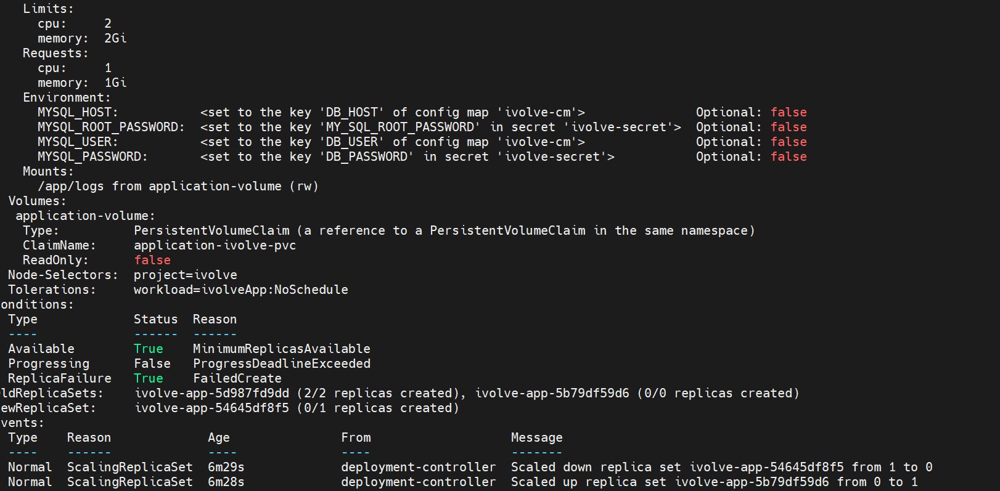

The describe shows the Resources block, the env pulled from `ivolve-cm` and `ivolve-secret`, the `/app/logs` mount from `application-ivolve-pvc`, `Node-Selectors: project=ivolve` and the toleration — everything from Lab 15 intact.

## Step 2 — The rollout stalls: the quota from Lab 11 is full

```bash
k rollout status deployment -n ivolve ivolve-app
```


The rollout waits with `0 out of 2 new replicas have been updated`. In `describe deployment` the `Conditions` block shows `ReplicaFailure True FailedCreate`:

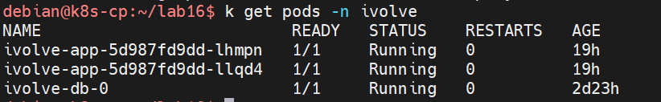

The `RollingUpdate` strategy defaults to `maxSurge: 25%` — on 2 replicas that rounds up to 1 extra pod. Replacing a pod needs a moment of overlap: 2 old app pods + `ivolve-db-0` + 1 new app pod = 4 pods, but the Lab 11 quota caps `ivolve` at 3. The API server refuses to create the surge pod, so the new ReplicaSet stays at `0/1` created.

## Step 3 — Raise the quota to 4 pods

```bash
k edit resourcequotas -n ivolve ivolvequota
```

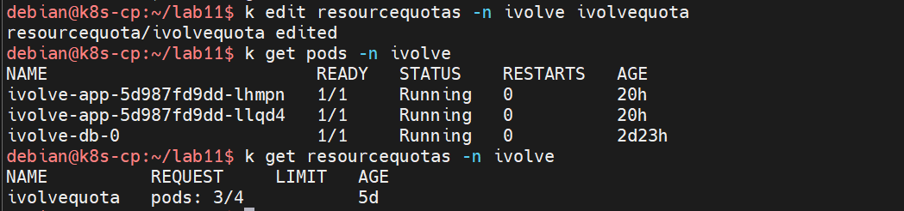

`get resourcequotas` now shows `pods: 3/4` — 3 pods in use, hard limit 4, room for exactly one surge pod.

## Step 4 — The rolling update resumes

With the quota raised, the new ReplicaSet can create its pod:

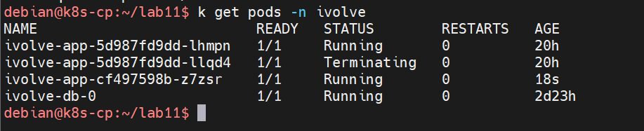

The deployment controller now alternates: it scales up the new ReplicaSet only far enough to keep one old pod as a fallback, then drains the next old one.

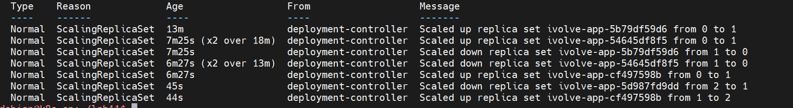

But the new pod never leaves `Pending`:

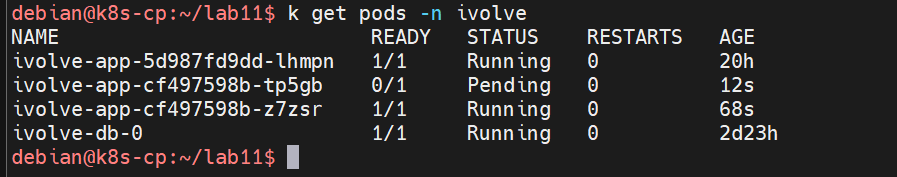

## Step 5 — The requests are the problem

The pod describe explains why:

```
Warning  FailedScheduling  4m33s  default-scheduler  0/2 nodes are available: 1 Insufficient cpu,
1 node(s) had untolerated taint(s). no new claims to deallocate, preemption: 0/2 nodes are available:
1 No preemption victims found for incoming pod, 1 Preemption is not helpful for scheduling.
```

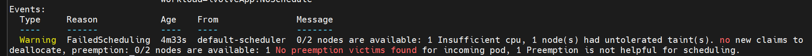

Reading the two rejections:

- `1 node(s) had untolerated taint(s)` — `k8s-cp`. The app doesn't tolerate the control-plane taint, so it can never land there.
- `1 Insufficient cpu` on the remaining node — `k8s-worker` cannot honor `requests.cpu: 1` on top of everything already running on it. Only the worker is schedulable for this pod, so a request of a full core is simply more capacity than the node has free.
- The scheduler was offered preemption and refused it — no running pod can be evicted to free the required CPU.

## Step 6 — Lower the requests

Requests are a scheduling promise, not a target load, so they were set to what the app actually needs while a headroom limit stays in place: `requests: cpu 200m, memory 500Mi` and `limits: cpu 1000m, memory 1Gi` — the values now in `app-deployment-ivolve-resources-limit.yaml`.

```bash
k apply -f app-deployment-ivolve-resources-limit.yaml -n ivolve
watch -n2 kubectl get pods -n ivolve
```

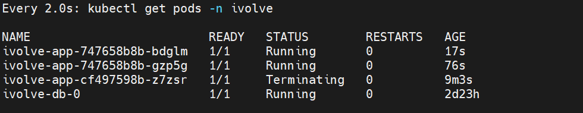

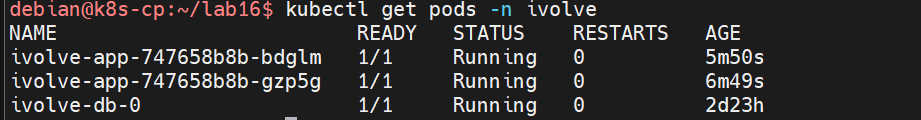

Both replicas are `1/1 Running` on the same ReplicaSet — `200m` fits on `k8s-worker`, so the scheduler admits the pods immediately, and the Deployment leaves the poisoned `Insufficient cpu` ReplicaSet behind.

## Step 7 — Install metrics-server to use kubectl top

To prove what the pods really consume, the natural tool is:

```bash
kubectl top pod
```

This command only works when metrics-server is running in the cluster:

> Use `kubectl top pod` to monitor real-time resource usage (metric server must be running in the cluster).

Why it must be installed: in a plain kubeadm cluster nothing serves the `metrics.k8s.io` API. `kubectl top` does not scrape the kubelets itself — it queries that Metrics API, and metrics-server is the component that populates it. It polls every node's kubelet for container usage, aggregates it, and serves it to `kubectl top`, `kubectl describe` nodes, and autoscalers like the HPA. Without it the command fails with `error: Metrics API not available`. That is why it was installed with its official manifest:

```bash
kubectl apply -f https://github.com/kubernetes-sigs/metrics-server/releases/latest/download/components.yaml
```

The metrics-server pod itself is not scheduled at first, for the same taint reason as in Step 5 — it tolerates neither the worker taint nor the control-plane taint, so both nodes were rejected as `untolerated taint(s)`. The two `NoExecute` tolerations shown are the defaults Kubernetes adds to every pod (`not-ready`/`unreachable`, for 300s each):

```
Warning  FailedScheduling  4m28s  default-scheduler  0/2 nodes are available: 2 node(s) had untolerated taint(s).
no new claims to deallocate, preemption: 0/2 nodes are available: 2 Preemption is not helpful for scheduling.
```

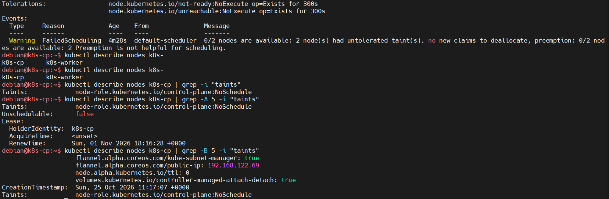

Cross-checking the taint on the control-plane node, then on both by name:

```bash
kubectl describe nodes k8s-cp | grep -A 5 -i "taints"
```

`k8s-cp` shows `Taints: node-role.kubernetes.io/control-plane:NoSchedule` and `Unschedulable: false` — the FailureScheduling came from taints, not cordoning. (The gap between this `Pending` state and the pod running below is not captured in the screenshots.)

## Step 8 — Fix the metrics-server to kubelet TLS errors

Once running, the pod still refused to serve data. The logs showed:

```
Failed to scrape node err="Get \"https://192.168.122.242:10250/metrics/resource\"":
tls: failed to verify certificate: x509: cannot validate certificate for 192.168.122.242
because it doesn't contain any IP SANs" node="k8s-worker"
Failed probe probe="metric-storage-ready" err="no metrics to serve"
```

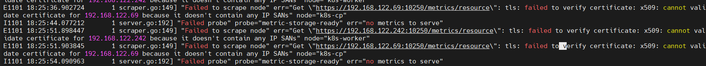

metrics-server talks to each kubelet over `https://<node-IP>:10250`, but the kubelet's self-signed certificate is issued for the node name only — it contains no IP SANs, so TLS verification against an IP address fails and no metrics are ever collected. The standard fix for an untrusted lab cluster is to add `--kubelet-insecure-tls`:

```bash
kubectl patch deployment metrics-server \
  -n kube-system \
  --type='json' \
  -p='[{"op":"add","path":"/spec/template/spec/containers/0/args/-","value":"--kubelet-insecure-tls"}]'
```

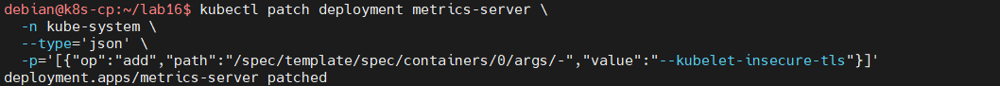

Expected output: `deployment.apps/metrics-server patched`. A new metrics-server pod rolls out in `kube-system`:

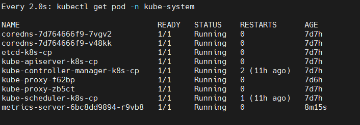

## Step 9 — Measure the pods

```bash
k top -n ivolve pod ivolve-app-747658b8b-bdglm
```

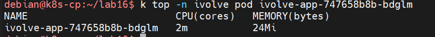

The request of `cpu: 200m` and the measured `2m` show that requests do not cap usage — they are the reservation the scheduler books, while the running container sits far below it. This is exactly the data metrics-server now feeds `kubectl top` in place of the `Metrics API not available` error.

## Result

The `ivolve-app` container now carries `requests` of `200m` CPU / `500Mi` memory and `limits` of `1000m` CPU / `1Gi` memory. The scheduler enforces the requests (`Insufficient cpu` until they fit on `k8s-worker`), the quota from Lab 11 was raised to 4 pods to let the rolling update keep one surge pod, and metrics-server — installed and tuned with `--kubelet-insecure-tls` — makes `kubectl top pod` report live CPU and memory usage per pod.

## Files

| File | Contents |
|---|---|
| `app-deployment-ivolve-resources-limit.yaml` | Lab 15 Deployment manifest with the `resources` block added to `application-ivolve` |

## Cleanup

```bash
kubectl delete deployment metrics-server -n kube-system
kubectl edit resourcequotas -n ivolve ivolvequota   # set hard pods back to 3
```

Removing metrics-server takes the `metrics.k8s.io` API with it, which makes `kubectl top` fail again — deliberate, so deleting the extra deployment restores the cluster to its pre-lab state.
