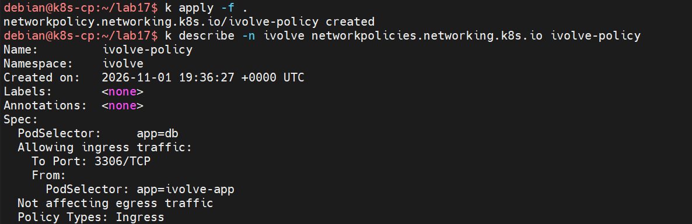

# Lab 17 — Network Policies

Restrict access to MySQL so only the `ivolve-app` pods can reach it on TCP `3306`, and every other ingress to the database pods is denied.

| Item | Value |
|---|---|
| NetworkPolicy | `ivolve-policy` in `ivolve` |
| Applies to | pods with `app: db` (`ivolve-db-0`) |
| Allowed ingress | pods with `app: ivolve-app`, TCP `3306` |
| Policy types | `Ingress` only |
| Egress | not restricted |
| CNI | Flannel (does not enforce NetworkPolicy — see note) |

Prerequisites from earlier labs: the `ivolve` namespace, the MySQL pod `ivolve-db-0` labelled `app: db` and its Service `ivolve-db-svc` (Lab 14), and the `ivolve-app` pods labelled `app: ivolve-app` (Labs 15–16).

The screenshot uses `k` as an alias for `kubectl`.

## Step 1 — The policy manifest

```yaml
apiVersion: networking.k8s.io/v1
kind: NetworkPolicy
metadata:
  name: ivolve-policy
  namespace: ivolve
spec:
  podSelector:
    matchLabels:
      app: db
  policyTypes:
    - Ingress
  ingress:
    - from:
        - podSelector:
            matchLabels:
              app: ivolve-app
      ports:
        - protocol: TCP
          port: 3306
```

How it reads:

- `podSelector: app=db` — the policy guards the MySQL pod. A NetworkPolicy is namespaced, so only pods in `ivolve` are affected.
- `policyTypes: [Ingress]` — the policy controls incoming traffic only; egress from the database is untouched.
- `ingress.from.podSelector: app=ivolve-app` — the only permitted source. A bare `podSelector` means pods in the **same namespace**; pods in other namespaces would need a `namespaceSelector`.
- `ports: TCP/3306` — even an allowed source may only use the MySQL port.

Once a pod is selected and an Ingress policy exists, all ingress that is not explicitly allowed is denied. This is an allow-list, not a block-list — no separate "deny" rule is needed.

## Step 2 — Apply and verify

```bash
cd ~/lab17
kubectl apply -f .
kubectl get networkpolicy -n ivolve
kubectl describe -n ivolve networkpolicies.networking.k8s.io ivolve-policy
```



Expected apply output:

```
networkpolicy.networking.k8s.io/ivolve-policy created
```

The describe output confirms the rendered rule:

```
PodSelector:     app=db
Allowing ingress traffic:
  To Port: 3306/TCP
  From:
    PodSelector: app=ivolve-app
Not affecting egress traffic
Policy Types: Ingress
```

## Step 3 — What the policy allows

| Source | Destination | Port | Result |
|---|---|---|---|
| `app=ivolve-app` pods in `ivolve` | `app=db` pod | `3306/TCP` | allowed |
| Any other pod in `ivolve` | `app=db` pod | `3306/TCP` | denied |
| Any source | `app=db` pod | any other port | denied |
| Any pod | outside the `app=db` pod | any | unaffected |

Enforcement happens in the CNI data path, not in the API server, so the result depends on the plugin below.

## Note — enforcement with Flannel

The cluster from Lab 9 uses Flannel, which provides pod connectivity but does not implement NetworkPolicy. The API server accepts and stores `ivolve-policy`, and `kubectl describe` renders it exactly as shown, but Flannel will not filter any packets — all pods can still reach MySQL.

The manifest is valid and portable. Actual enforcement requires a policy-capable CNI such as Calico, Cilium or kube-router. This lab demonstrates the policy object and its intended rule; no traffic-blocking test can succeed on the current Flannel setup.

## Result

`ivolve-policy` selects the MySQL pod (`app=db`) and allows ingress only from `ivolve-app` pods on TCP `3306`. The describe output confirms the target, the allowed source and port, and that egress is unaffected. On a policy-capable CNI, all other inbound connections to MySQL would be dropped; on this Flannel cluster the policy is stored but not enforced.

## Files

| File | Contents |
|---|---|
| `network-policy-ivolve.yaml` | NetworkPolicy allowing `app=ivolve-app` → `app=db` on TCP `3306` |

## Cleanup

```bash
kubectl delete networkpolicy ivolve-policy -n ivolve
```

Deleting the policy removes the restriction; without it, no policy limits ingress to the MySQL pod.
