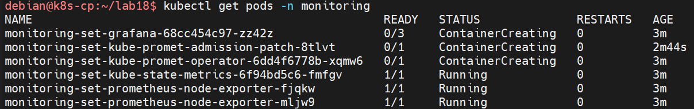
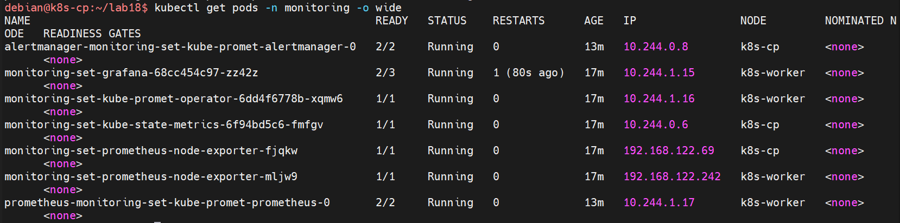
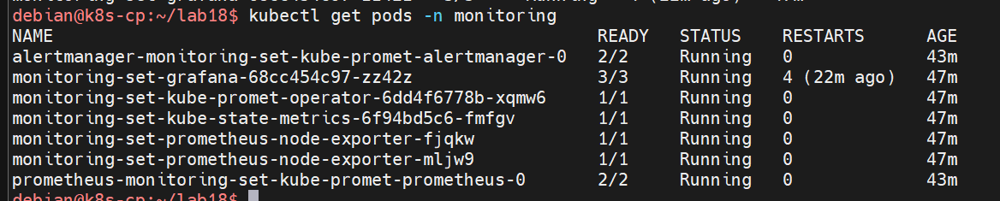
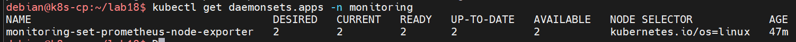
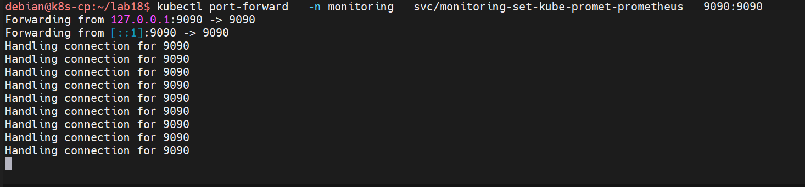
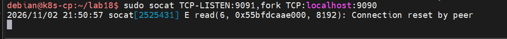
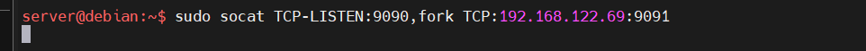
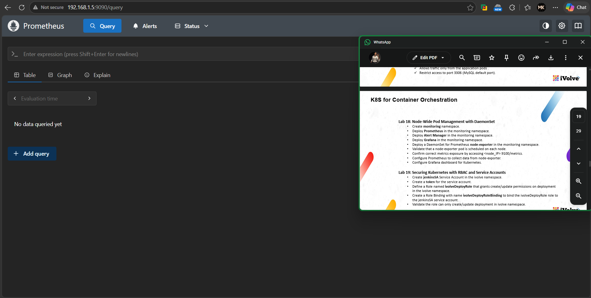
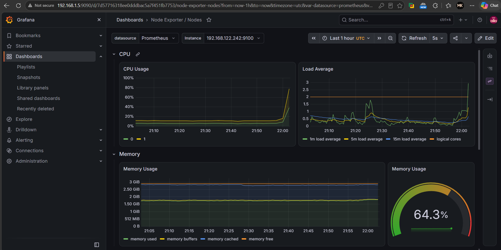
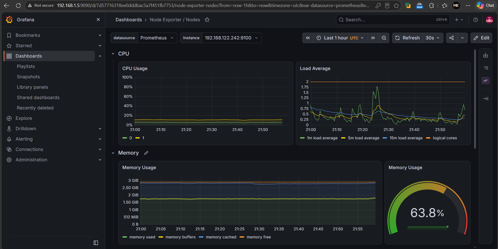

# Lab 18 — Monitoring Stack with Helm (kube-prometheus-stack)

Install Helm, deploy the `kube-prometheus-stack` chart into a `monitoring` namespace, let every component tolerate the control-plane taint so it can run on both nodes, and confirm Prometheus scrapes `node-exporter` from each node and Grafana renders the Node Exporter dashboards.

| Item | Value |
|---|---|
| Helm release | `monitoring-set` |
| Chart | `prometheus-community/kube-prometheus-stack` |
| Namespace | `monitoring` |
| Components | Prometheus, Alertmanager, Grafana, prometheus-operator, node-exporter, kube-state-metrics |
| Node-exporter | DaemonSet, one pod per node (`k8s-cp`, `k8s-worker`) |

The screenshots use `k` as an alias for `kubectl`.

## Step 1 — Install Helm

`get_helm.sh` is the official Helm installer script:

```bash
cd ~/lab18
chmod 700 get_helm.sh
sudo ./get_helm.sh
helm version
```

Expected: Helm is installed to `/usr/local/bin/helm` and `helm version` prints the client version.

## Step 2 — Prepare the chart values

The control plane carries a `node-role.kubernetes.io/control-plane:NoSchedule` taint, so by default stack components cannot land on `k8s-cp`. `values.yaml` adds a toleration (`operator: Exists`, `effect: NoSchedule`) to every component:

```yaml
prometheus:
  prometheusSpec:
    tolerations:
      - operator: Exists
        effect: NoSchedule

alertmanager:
  alertmanagerSpec:
    tolerations:
      - operator: Exists
        effect: NoSchedule

grafana:
  tolerations:
    - operator: Exists
      effect: NoSchedule

prometheusOperator:
  tolerations:
    - operator: Exists
      effect: NoSchedule

kube-state-metrics:
  tolerations:
    - operator: Exists
      effect: NoSchedule

prometheus-node-exporter:
  tolerations:
    - operator: Exists
      effect: NoSchedule
```

`operator: Exists` tolerates any taint value with that key-less match, which lets Prometheus, Alertmanager, Grafana and the operator schedule on the control plane as well as the worker.

## Step 3 — Add the repo and install the release

```bash
helm repo add prometheus-community https://prometheus-community.github.io/helm-charts
helm repo update
kubectl create namespace monitoring
helm install monitoring-set prometheus-community/kube-prometheus-stack \
  -n monitoring --values values.yaml
```

The release name `monitoring-set` prefixes every object it creates (for example `monitoring-set-grafana`, and `prometheus-monitoring-set-kube-promet-prometheus-0` for the stateful Prometheus pod).

Right after the install, most pods are still pulling images while `kube-state-metrics` and the node exporters are already up:



## Step 4 — Verify the stack

Full pod listing a few minutes later — every component is `Running` and spread over both nodes:



All pods eventually reach full readiness: `2/2` for Alertmanager and Prometheus, `3/3` for Grafana, `1/1` for the operator, `kube-state-metrics` and the node exporters:



The node exporter runs as a DaemonSet, one pod per eligible node, with `2/2` desired, current, ready and up-to-date:



```bash
kubectl get pods -n monitoring -o wide
kubectl get daemonsets.apps -n monitoring
```

The `-o wide` output confirms the DaemonSet effect: a node-exporter pod on each node with the node's own IP (`192.168.122.69` on `k8s-cp`, `192.168.122.242` on `k8s-worker`), which is exactly how `<node_ip>:9100/metrics` is exposed per node.

## Step 5 — Open Prometheus

`kubectl port-forward` makes the Prometheus service reachable on localhost:

```bash
kubectl port-forward -n monitoring svc/monitoring-set-kube-promet-prometheus 9090:9090
```



Expected: `Forwarding from 127.0.0.1:9090 -> 9090` and `Forwarding from [::1]:9090 -> 9090`, with a `Handling connection` line for every request.

Port-forwarding binds to localhost only, so browsing from an external machine needs a relay. On the control-plane VM, socat forwards its own port `9091` into the local port-forward at `9090`:

```bash
sudo socat TCP-LISTEN:9091,fork TCP:localhost:9090
```



On the next machine in the chain, socat listens on `9090` and relays to the VM's `9091`:

```bash
sudo socat TCP-LISTEN:9090,fork TCP:192.168.122.69:9091
```



Now `http://<relay-ip>:9090` reaches the Prometheus web UI in a browser:



## Step 6 — Prometheus collects from node-exporter

Prometheus is configured by the chart to scrape the node exporters on both nodes. The instance label looks like `192.168.122.242:9100` — the node IP with the exporter port. Queries against metrics such as `node_cpu_seconds_total` return per-node series, confirming the scrape targets deliver `<node_ip>:9100/metrics`.

## Step 7 — Grafana dashboards

Grafana ships pre-provisioned with the Prometheus datasource. Opening the **Node Exporter / Nodes** dashboard shows CPU usage, load average and memory usage for the node instances Prometheus scrapes:





The dashboard reads live node metrics end to end: node-exporter exposes them on each node, Prometheus scrapes and stores them, and Grafana renders them.

## Result

The `monitoring` namespace runs the full kube-prometheus-stack: Prometheus, Alertmanager and Grafana running on both nodes thanks to the tolerations, and a node-exporter DaemonSet providing one metrics pod per node. Prometheus scrapes both instances, and Grafana renders live Node Exporter dashboards.

## Files

| File | Contents |
|---|---|
| `get_helm.sh` | Official Helm installer script |
| `values.yaml` | Tolerations for every stack component so it can schedule on both nodes |

## Cleanup

```bash
helm uninstall monitoring-set -n monitoring
kubectl delete namespace monitoring
```

Uninstalling the release removes the workloads; deleting the namespace removes everything the chart left behind.
