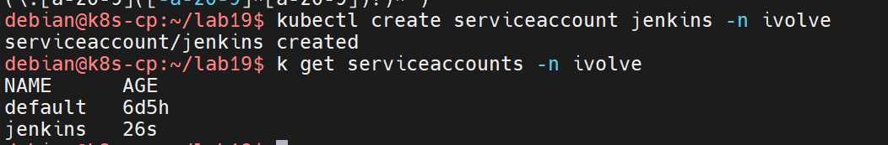
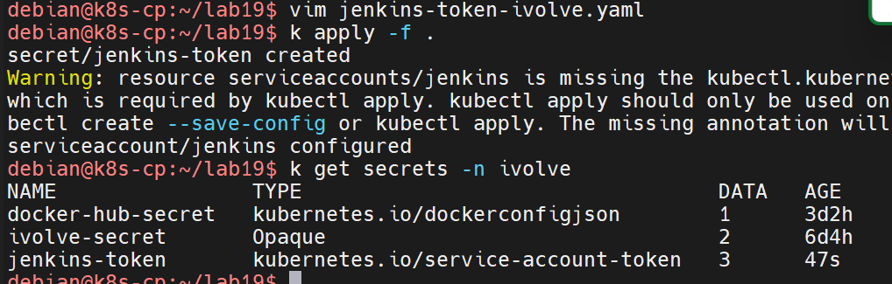
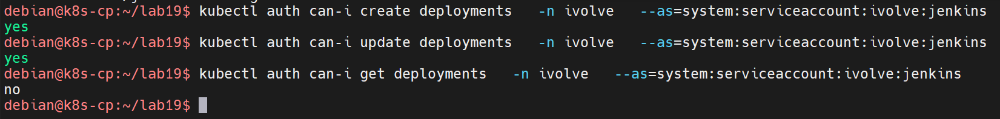

# Lab 19 — RBAC for Jenkins: Service Account, Role and RoleBinding

Create a dedicated `jenkins` service account in the `ivolve` namespace, give it a token secret, and grant it only the permissions Jenkins needs — create and update deployments — through a `Role` and a `RoleBinding`.

| Item | Value |
|---|---|
| Namespace | `ivolve` |
| ServiceAccount | `jenkins` |
| Role | `ivolve-deploy-role` |
| RoleBinding | `ivolve-deploy-rolebinding` |
| Token secret | `jenkins-token`, type `kubernetes.io/service-account-token` |
| Granted verbs | `create`, `update` on `deployments` only |

Prerequisite from earlier labs: the `ivolve` namespace (Lab 11).

The screenshots use `k` as an alias for `kubectl`.

## Step 1 — Create the service account

```bash
kubectl create serviceaccount jenkins -n ivolve
k get serviceaccounts -n ivolve
```



Expected output: `serviceaccount/jenkins created`. The listing shows the new `jenkins` account next to the `default` one.

## Step 2 — Define the Role and RoleBinding

`role-jenkins-ivolve.yaml` — a namespace-scoped `Role` that grants only what a CI deployment job needs:

```yaml
apiVersion: rbac.authorization.k8s.io/v1
kind: Role
metadata:
  name: ivolve-deploy-role
  namespace: ivolve
rules:
  - apiGroups: ["apps"]
    resources: ["deployments"]
    verbs: ["create", "update"]
```

- A `Role` is namespaced, so these permissions apply only inside `ivolve`.
- Only `apps/deployments` with the verbs `create` and `update` — no listing, deleting or touching other resources.

`role-binding-jenkins-ivolve.yaml` — binds the role to the service account:

```yaml
apiVersion: rbac.authorization.k8s.io/v1
kind: RoleBinding
metadata:
  name: ivolve-deploy-rolebinding
  namespace: ivolve
subjects:
  - kind: ServiceAccount
    name: jenkins
    namespace: ivolve
roleRef:
  kind: Role
  name: ivolve-deploy-role
  apiGroup: rbac.authorization.k8s.io
```

## Step 3 — Token secret for the service account

`jenkins-token-ivolve.yaml` — a token of type `kubernetes.io/service-account-token` attached to the account through its `kubernetes.io/service-account.name` annotation:

```yaml
apiVersion: v1
kind: Secret
metadata:
  name: jenkins-token
  namespace: ivolve
  annotations:
    kubernetes.io/service-account.name: jenkins
type: kubernetes.io/service-account-token
```

Apply everything in the directory:

```bash
k apply -f .
k get secrets -n ivolve
```



Expected: `secret/jenkins-token created` (together with the role and rolebinding). The secret appears as type `kubernetes.io/service-account-token` with `3` data entries — the controller fills it with `token`, `ca.crt` and `namespace`, ready to be used by Jenkins against the cluster API.

The apply prints a warning that the service account is missing the `kubectl.kubernetes.io/last-applied-configuration` annotation. It is harmless here — it only means `kubectl apply` was not used when the account was created (it was created with `kubectl create`); the token still works because the link comes from the secret's annotation.

## Step 4 — Validate the permissions

`kubectl auth can-i` impersonates the service account to test exactly what it can do:

```bash
kubectl auth can-i create deployments  -n ivolve --as=system:serviceaccount:ivolve:jenkins
kubectl auth can-i update deployments  -n ivolve --as=system:serviceaccount:ivolve:jenkins
kubectl auth can-i get deployments     -n ivolve --as=system:serviceaccount:ivolve:jenkins
```



`create` and `update` on deployments answer `yes`; `get` answers `no` — the role grants nothing beyond the two verbs it lists, and nothing outside `ivolve`.

## Result

The `jenkins` service account in `ivolve` now authenticates with its `jenkins-token` secret and can only create and update deployments in its own namespace. Any other verb or resource is denied by RBAC, keeping Jenkins scoped to deploying the applications it owns.

## Files

| File | Contents |
|---|---|
| `service-account-ivolve.yaml` | `ServiceAccount` `jenkins` in `ivolve` |
| `role-jenkins-ivolve.yaml` | `Role` granting `create`/`update` on deployments in `ivolve` |
| `role-binding-jenkins-ivolve.yaml` | `RoleBinding` binding the role to `jenkins` |
| `jenkins-token-ivolve.yaml` | Service-account token secret for `jenkins` |

## Cleanup

```bash
kubectl delete rolebinding ivolve-deploy-rolebinding -n ivolve
kubectl delete role ivolve-deploy-role -n ivolve
kubectl delete secret jenkins-token -n ivolve
kubectl delete serviceaccount jenkins -n ivolve
```

The service account loses its credentials immediately after the secret is deleted, and the role and binding can no longer be reached once the account is gone.
