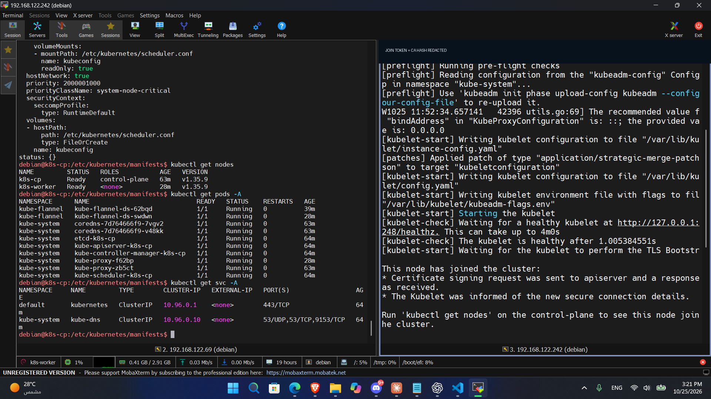
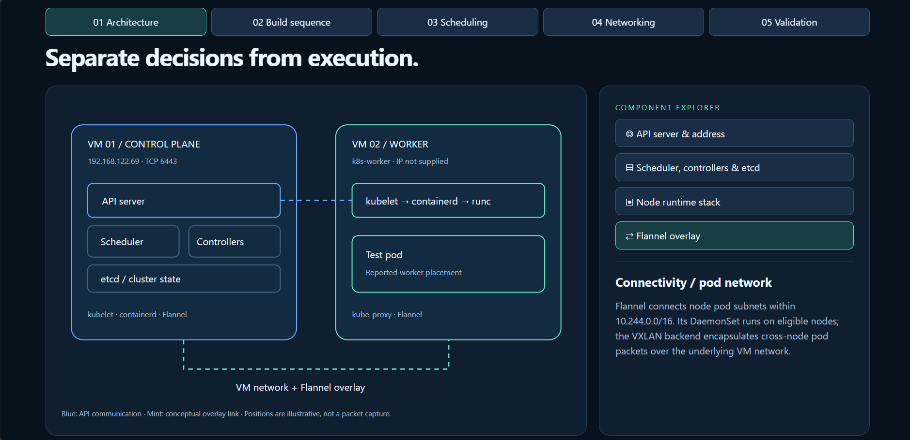
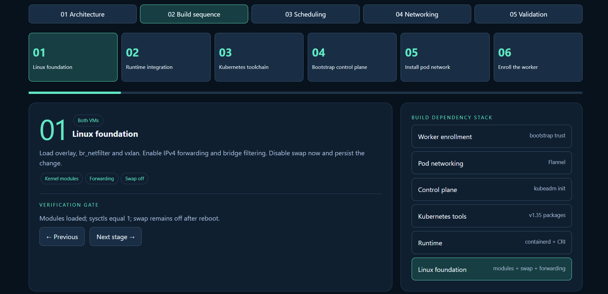

# Kubernetes v1.35 • two-VM kubeadm lab

One control plane, one worker, containerd, and a Flannel pod network.

## Record and scope

This guide reconstructs the commands supplied in **Kubeadm Initialization Checks**, with explicitly identified corrections and additions for reproducibility. The screenshots below were supplied by the user and provide point-in-time evidence for the items they visibly show. The cluster was not independently accessed during preparation of this README; all other checks described below remain expected checks until captured from the lab.

| Item | Documented value |
|---|---|
| Kubernetes | v1.35.9, as shown by the supplied cluster screenshot |
| Control-plane address | `192.168.122.69` |
| Worker | `k8s-worker`; `192.168.122.242` as shown in the supplied terminal screenshot |
| Control-plane hostname | `<CONTROL_PLANE_NODE_NAME>`; not supplied |
| Runtime | containerd; `unix:///run/containerd/containerd.sock` |
| Pod network | Flannel, `10.244.0.0/16` |
| OS / hypervisor / resources | Not supplied; commands assume an apt-based Linux guest with systemd |

Angle-bracket values are placeholders. Replace them with actual values before running commands. Shell snippets use Bash inside the Linux VMs, not PowerShell on the host. This is a single-control-plane learning lab, without high availability.

## 1. Prerequisites — both VMs

- Use supported Linux guests, unique hostnames, MAC addresses and product UUIDs, and sudo access. Allow at least 2 GiB RAM per machine and at least 2 CPUs on the control plane; more headroom helps.
- Keep `192.168.122.69` stable and assigned to the control-plane VM. Record the actual worker IP. Both nodes must reach one another over their chosen interfaces; a NAT network must still permit guest-to-guest communication.
- Ensure working DNS, time synchronization, package/image registry access and default routes. The pod CIDR must not overlap VM, VPN, host, or service networks. kubeadm normally uses service CIDR `10.96.0.0/12` unless configured otherwise.
- Allow TCP 6443 from worker/admin to API server and TCP 10250 from control plane to kubelets. Keep etcd TCP 2379–2380 restricted to its intended control-plane peers (only one here). Controller/scheduler TCP 10257/10259 are control-plane services; avoid exposing them externally. Flannel's Linux VXLAN backend needs UDP 8472 between nodes. NodePort TCP/UDP 30000–32767 is needed only if used. Check your actual firewall and Flannel backend.
- Install diagnostic netcat if missing: `sudo apt-get install -y netcat-openbsd`. Do not disable the firewall indiscriminately.

```bash
hostnamectl
ip -br address
ip route
free -h
nproc
cat /sys/class/dmi/id/product_uuid
timedatectl status
```

## 2. Kernel modules and forwarding — both VMs

The original notes wrote sysctls before loading modules and then reapplied them. The order below loads modules first so bridge sysctls exist on the first application; the original values are preserved.

```bash
sudo tee /etc/modules-load.d/k8s.conf >/dev/null <<'EOF'
overlay
br_netfilter
vxlan
EOF
sudo modprobe overlay
sudo modprobe br_netfilter
sudo modprobe vxlan

cat <<EOF | sudo tee /etc/sysctl.d/k8s.conf
net.ipv4.ip_forward = 1
net.bridge.bridge-nf-call-iptables  = 1
EOF
sudo sysctl --system

# Expected: modules present and both sysctls equal 1.
lsmod | grep -E 'overlay|br_netfilter|vxlan'
sysctl net.ipv4.ip_forward net.bridge.bridge-nf-call-iptables
```

`overlay` supports container filesystem layering; `br_netfilter` exposes bridge traffic to netfilter; `vxlan` supports the selected Flannel overlay. Forwarding lets Linux route packets. Persistent files restore configuration at boot.

## 3. Disable swap — both VMs

Preserved from the notes. This lab uses the default kubelet behavior requiring swap off.

```bash
sudo swapoff -a
swapon --show
sudo sed -i.bak -E \
  '/^[[:space:]]*[^#].*[[:space:]]swap[[:space:]]/s/^/#/' \
  /etc/fstab
```

Expected: `swapon --show` is empty, including after reboot. `/etc/fstab.bak` is the backup made by this command; repeating it can replace that backup. Review `/etc/fstab`. If swap is managed by zram or a systemd swap unit, disable that source separately; editing fstab alone is insufficient.

## 4. Install and configure containerd — both VMs

```bash
sudo apt-get update
sudo apt-get install -y containerd runc containernetworking-plugins ca-certificates curl gpg
sudo install -d -m 0755 /opt/cni/bin
for tool in bridge host-local loopback portmap; do
  if [ ! -e "/opt/cni/bin/$tool" ]; then
    sudo ln -s "/usr/lib/cni/$tool" "/opt/cni/bin/$tool"
  fi
done
ls -l /opt/cni/bin/{bridge,host-local,loopback,portmap}
containerd --version
```

These symlinks preserve the supplied distro-specific approach. Check that `/usr/lib/cni/{bridge,host-local,loopback,portmap}` really contains executable binaries. Some distributions use another directory. A symlink can exist but point to a missing binary; use `test -x /opt/cni/bin/bridge` and repeat for each plugin. Do not overwrite valid existing CNI binaries. Flannel installs its own `flannel` plugin; the helper binaries still need to be present.

The notes used `mkdir -p /etc/containerd` and `vim` without sudo, implying a root shell. The corrected commands below work from a sudo-enabled account. Back up an existing runtime configuration before replacing it; generate defaults only for a fresh lab.

```bash
sudo mkdir -p /etc/containerd
# If a config already exists, preserve it first:
# sudo cp -a /etc/containerd/config.toml /etc/containerd/config.toml.before-k8s
containerd config default | sudo tee /etc/containerd/config.toml >/dev/null
sudo vim /etc/containerd/config.toml
```

**Required configuration addition:** the notes did not record the editor changes. Ensure CRI is enabled (`cri` must not be in `disabled_plugins`) and set the runc systemd cgroup option in the correct section for the installed version. Edit the generated section; do not append duplicate TOML tables.

containerd 1.x:

```toml
[plugins."io.containerd.grpc.v1.cri".containerd.runtimes.runc.options]
  SystemdCgroup = true
```

containerd 2.x:

```toml
[plugins.'io.containerd.cri.v1.runtime'.containerd.runtimes.runc.options]
  SystemdCgroup = true
```

Match kubelet and runtime cgroup drivers; kubeadm defaults kubelet to systemd. For Kubernetes v1.35, use a runtime with CRI v1 support. Confirm the distro's actual containerd version rather than assuming its major version.

```bash
sudo systemctl restart containerd && sudo systemctl enable containerd
sudo systemctl status containerd --no-pager
sudo ctr plugins ls
sudo journalctl -u containerd -n 60 --no-pager
```

Expected: service active, CRI-related plugin(s) healthy. A running containerd service alone does not prove its CRI endpoint works. After installing Kubernetes packages, optionally use `sudo crictl --runtime-endpoint unix:///run/containerd/containerd.sock info` if `crictl` is available.

## 5. Kubernetes v1.35 packages — both VMs

Exact repository and install commands from the notes:

```bash
sudo apt-get update
sudo apt-get install -y apt-transport-https ca-certificates curl gpg
sudo install -d -m 0755 /etc/apt/keyrings
curl -fsSL https://pkgs.k8s.io/core:/stable:/v1.35/deb/Release.key \
  | sudo gpg --dearmor --yes -o /etc/apt/keyrings/kubernetes-apt-keyring.gpg
sudo chmod 0644 /etc/apt/keyrings/kubernetes-apt-keyring.gpg
printf '%s\n' 'deb [signed-by=/etc/apt/keyrings/kubernetes-apt-keyring.gpg] https://pkgs.k8s.io/core:/stable:/v1.35/deb/ /' \
  | sudo tee /etc/apt/sources.list.d/kubernetes.list
sudo apt-get update
sudo apt-get install -y kubelet kubeadm kubectl
sudo apt-mark hold kubelet kubeadm kubectl
kubeadm version -o short
kubectl version --client
sudo systemctl enable --now kubelet
```

The repository selects the minor series, not one immutable patch. For exact reproduction, inspect `apt-cache madison kubeadm` and install matching available `kubelet=<PACKAGE_VERSION> kubeadm=<PACKAGE_VERSION> kubectl=<PACKAGE_VERSION>` on both nodes instead of the unversioned install line. Record `dpkg-query -W kubelet kubeadm kubectl containerd runc`. Kubelet may restart repeatedly before init/join creates its configuration; investigate persistent failures afterward.

Original port check:

```bash
nc 127.0.0.1 6443 -zv -w 2
```

Before initialization, connection refusal can be expected because no API server exists. This is a local listener check, not proof of worker reachability. If the port is occupied before init, identify the listener rather than ignoring it.

## 6. Initialize — control plane only

The latest notes omit `--apiserver-advertise-address`; an earlier supplied command includes it. **Run only one init variant once on a fresh control plane.** Recommended explicit variant for this VM address:

```bash
sudo kubeadm init \
  --apiserver-advertise-address=192.168.122.69 \
  --pod-network-cidr=10.244.0.0/16 \
  --cri-socket=unix:///run/containerd/containerd.sock
```

Latest supplied variant, retained verbatim:

```bash
sudo kubeadm init \
  --pod-network-cidr=10.244.0.0/16 \
  --cri-socket=unix:///run/containerd/containerd.sock
```

- `sudo`: allows host configuration and certificate creation.
- `kubeadm init`: bootstraps the local control plane and prints worker join instructions.
- `--apiserver-advertise-address`: selects this API server's advertised local IP. It is optional when automatic selection chooses the correct reachable interface; set it explicitly on multi-interface VMs. It does not assign the IP, open a firewall, or provide an HA endpoint.
- `--pod-network-cidr`: enables node pod subnet allocation from the range matching Flannel.
- `--cri-socket`: selects containerd explicitly.

For strict patch pinning, add `--kubernetes-version=v1.35.<PATCH>` after replacing the placeholder with the chosen compatible patch. Record the actual version printed by init. Keep the real printed join command private.

Configure kubectl for your regular user on the control plane:

```bash
mkdir -p $HOME/.kube
sudo cp -i /etc/kubernetes/admin.conf $HOME/.kube/config
sudo chown $(id -u):$(id -g) $HOME/.kube/config
```

`admin.conf` grants cluster administration. Do not publish it, private keys, or join tokens in a portfolio.

Inspect generated artifacts and initial state (from the notes):

```bash
sudo ls -l /etc/kubernetes/manifests
sudo ls -l /etc/kubernetes/pki
sudo ss -lntp | grep -E ':6443|:2379|:2380' || true
sudo journalctl -u kubelet -n 40 --no-pager
kubectl cluster-info
kubectl get nodes -o wide
kubectl -n kube-system get pods -o wide
```

Expected artifacts: static pod manifests for API server, scheduler, controller manager, and local etcd, plus PKI files. `|| true` prevents the grep's empty match from failing the shell line; it does not establish success. Before CNI is ready, a node may be NotReady and CoreDNS Pending.

## 7. Install Flannel — kubectl on control plane

Exact supplied installation and checks:

```bash
kubectl apply -f https://github.com/flannel-io/flannel/releases/latest/download/kube-flannel.yml
kubectl -n kube-flannel rollout status daemonset/kube-flannel-ds --timeout=180s
kubectl -n kube-flannel get ds,pods -o wide
kubectl get nodes -o wide
```

`latest` is a moving release URL; the original Flannel release was not recorded. For a reproducible rerun, download the manifest from a chosen release, inspect that its network is `10.244.0.0/16`, record its release and SHA-256, then apply the saved file. Do not run both methods unnecessarily. Verify its backend and required ports. The DaemonSet adds Flannel to eligible nodes, including the worker after join. Flannel provides connectivity; this lab does not demonstrate NetworkPolicy enforcement.

## 8. Join the worker

After completing sections 1–5 on the worker, generate fresh join instructions on the control plane:

```bash
sudo kubeadm token create --print-join-command
```

The notes omitted sudo; it is included here because the command commonly needs access to the root-owned admin configuration. Copy the actual command to the worker and append the runtime socket if absent. **Structure only — replace both placeholders with real generated values:**

```bash
sudo kubeadm join 192.168.122.69:6443 \
  --token <REAL_JOIN_TOKEN> \
  --discovery-token-ca-cert-hash sha256:<REAL_CA_HASH> \
  --cri-socket=unix:///run/containerd/containerd.sock
```

The token authenticates bootstrap; the CA hash verifies the cluster CA. No token or hash is invented here. Do not run `kubeadm init` on the worker. From the worker, `nc -zv -w 2 192.168.122.69 6443` should reach the API server after initialization.

## 9. Validate the cluster and scheduling

Additional validation commands below were not included as captured results in the notes. Run from configured kubectl:

```bash
kubectl get nodes -o wide
kubectl wait --for=condition=Ready nodes --all --timeout=180s
kubectl -n kube-system get pods -o wide
kubectl -n kube-flannel get ds,pods -o wide
kubectl get events -A --sort-by=.metadata.creationTimestamp
kubectl get nodes -o custom-columns=NAME:.metadata.name,TAINTS:.spec.taints
kubectl describe node <CONTROL_PLANE_NODE_NAME>
```

Expected: two nodes Ready; healthy system pods; Flannel desired/current/ready counts consistent with eligible nodes. A worker can show role `<none>` while functioning normally.

kubeadm applies `node-role.kubernetes.io/control-plane:NoSchedule` to the control plane by default. The scheduler avoids placing new ordinary pods there unless a matching toleration exists. This explains the user's reported worker placement when that worker was eligible. It does not mean every system pod runs on the worker: static control-plane pods and system DaemonSets follow different mechanisms/tolerations. Read `.spec.taints` on the Node object; the taint is not merely a setting in a local file. Keep it for this two-node lab.

### Test workload (added reproducible example)

Use an available, trusted image; record its digest if exact reproduction matters. This example is not a claim about the user's original test image.

```bash
kubectl create namespace lab-test
kubectl -n lab-test run web-test --image=nginx:stable --restart=Never
kubectl -n lab-test wait --for=condition=Ready pod/web-test --timeout=180s
kubectl -n lab-test get pod web-test -o wide
kubectl -n lab-test describe pod web-test
kubectl -n lab-test exec web-test -- curl -fsS http://127.0.0.1/
```

Expected: a Running/Ready pod assigned to the eligible worker and an HTTP response. This checks scheduling and local container HTTP, not cross-node VXLAN connectivity. For service/DNS validation:

```bash
kubectl -n lab-test expose pod web-test --port=80 --name=web-test
kubectl -n lab-test run dns-http-check --image=busybox:1.37 \
  --restart=Never --command -- sh -c \
  'nslookup web-test.lab-test.svc.cluster.local && wget -qO- http://web-test.lab-test.svc.cluster.local'
kubectl -n lab-test logs -f dns-http-check
```

Both ordinary pods will usually share the only worker; this does not prove cross-node pod traffic. A deliberate cross-node test needs pods on distinct nodes (for example an explicitly tolerated test pod on the control plane) and separate evidence. A service response alone does not establish that the VXLAN path was traversed.

Cleanup only the added test namespace when finished: `kubectl delete namespace lab-test`.

## 10. Troubleshooting

| Symptom | Inspect / likely action |
|---|---|
| sysctl key missing | Load `br_netfilter`, then rerun `sudo sysctl --system`. |
| kubelet won't start after init/join | `sudo journalctl -u kubelet -n 100 --no-pager`; check swap, runtime endpoint, cgroup alignment and configuration. |
| CRI unavailable | `sudo ctr plugins ls`, containerd journal, disabled CRI plugins, correct version-specific TOML section; restart after edits. |
| CNI binary missing / sandbox failure | Test executable symlink targets under `/opt/cni/bin`; inspect `/etc/cni/net.d` and kubelet logs. |
| Node NotReady / CoreDNS Pending | `kubectl describe node <NODE_NAME>`; inspect Flannel pods, events, CIDR and CNI setup. |
| Flannel CrashLoop / traffic fails | `kubectl -n kube-flannel logs daemonset/kube-flannel-ds -c kube-flannel --tail=100`; check `br_netfilter`, interface selection, UDP 8472 and MTU. |
| Join timeout | Worker route to `192.168.122.69`, TCP 6443 firewall, API listener, advertised address and clock. |
| Token expired / CA mismatch | Generate a fresh real join command; confirm it belongs to this cluster. Do not bypass CA verification. |
| kubectl connection refused / auth error | Check kubeconfig and `kubectl config current-context`, API server health and certificate validity; do not expose admin.conf. |
| Pod Pending | `kubectl describe pod` for scheduling events; check taints, resources and worker Ready state. |
| ImagePullBackOff | Inspect pod events, image reference, DNS, registry access and authentication. |
| init preflight finds old files/ports | Inspect prior state and logs. Do not rerun init or reset a working cluster blindly. |

## 11. Evidence and portfolio handoff

### Supplied screenshots

The first screenshot visibly shows both `k8s-cp` and `k8s-worker` in `Ready` state on Kubernetes `v1.35.9`; the listed Flannel, CoreDNS, etcd, API server, controller manager, scheduler and kube-proxy pods are Running/Ready in that capture. Its adjacent terminal shows the worker join completed. The screenshot's worker terminal title shows `192.168.122.242`. This is useful point-in-time evidence, not a guarantee of current health. The join token and CA hash present in the original image have been redacted in the copy below. If that token is still valid, expire it or wait for its short lifetime to end before sharing the original screenshot.



The next two screenshots document the visual presentation's architecture and build sequence views; they are portfolio visuals, not additional cluster telemetry.





Still useful to capture separately: Node taints, an actual test pod assignment, and DNS/HTTP checks. The supplied screenshots do not show these. Record OS release, VM resources, chosen Flannel release/backend and manifest checksum if exact reproducibility matters. Do not publish tokens, kubeconfigs, keys or private certificate material.

Open `kubernetes-lab.html` directly in a modern browser. It works offline with embedded styles, diagrams and scripts. Its workflow, packet flow and scheduling controls are conceptual demonstrations, not live monitoring. Presenter mode and browser printing support instructor delivery; LinkedIn does not execute an attached HTML presentation inline, so share it through a repository/hosted link or record the interaction yourself.

## Official references

- [Kubernetes v1.35: installing kubeadm](https://v1-35.docs.kubernetes.io/docs/setup/production-environment/tools/kubeadm/install-kubeadm/)
- [Kubernetes v1.35: creating a cluster](https://v1-35.docs.kubernetes.io/docs/setup/production-environment/tools/kubeadm/create-cluster-kubeadm/)
- [Kubernetes v1.35: container runtimes](https://v1-35.docs.kubernetes.io/docs/setup/production-environment/container-runtimes/)
- [kubeadm init flags](https://kubernetes.io/docs/reference/setup-tools/kubeadm/kubeadm-init/)
- [Kubernetes ports and protocols](https://kubernetes.io/docs/reference/networking/ports-and-protocols/)
- [Flannel installation and release manifest guidance](https://github.com/flannel-io/flannel/blob/master/README.md)
- [Flannel Kubernetes configuration](https://github.com/flannel-io/flannel/blob/master/Documentation/kubernetes.md)

Prepared 25 October 2026. References support configuration guidance; they do not verify this lab's runtime state.
